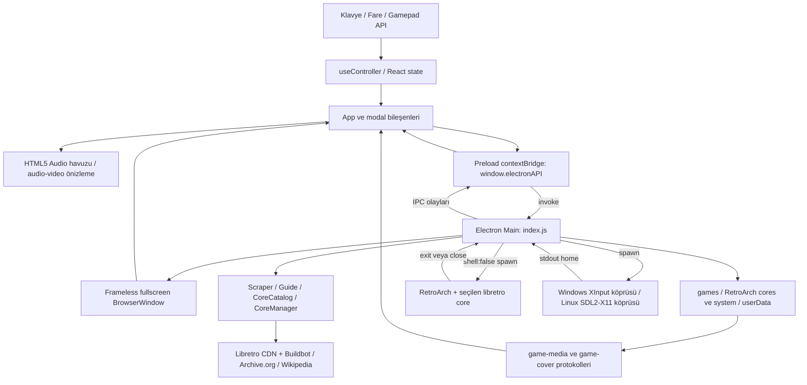
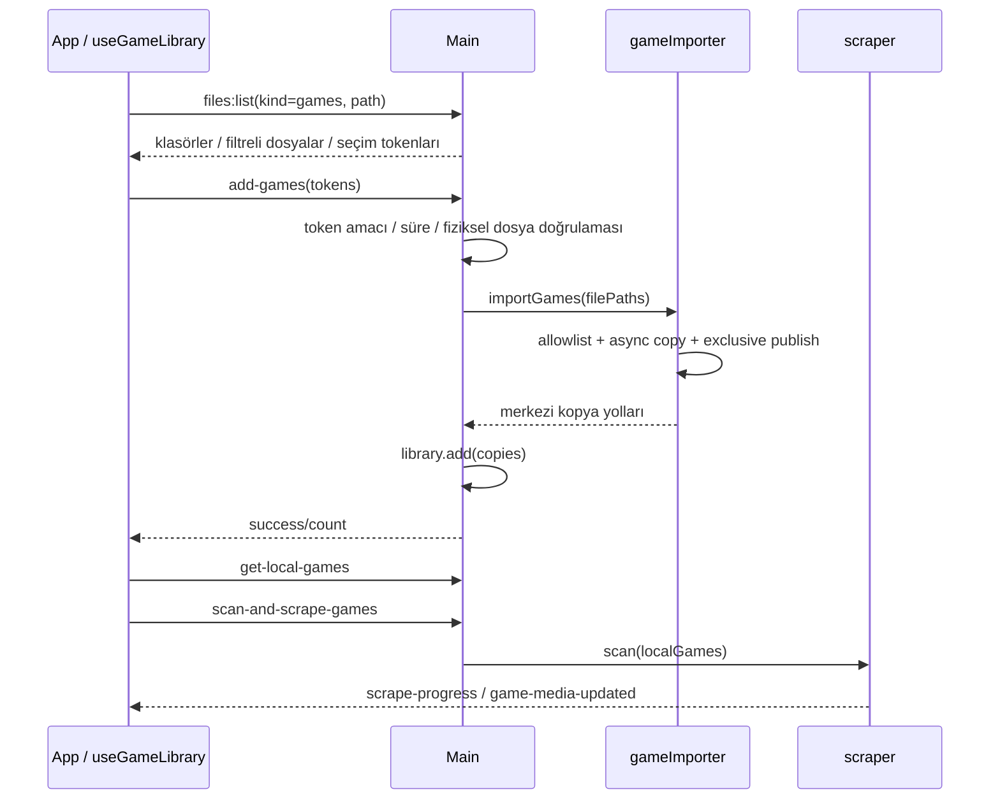
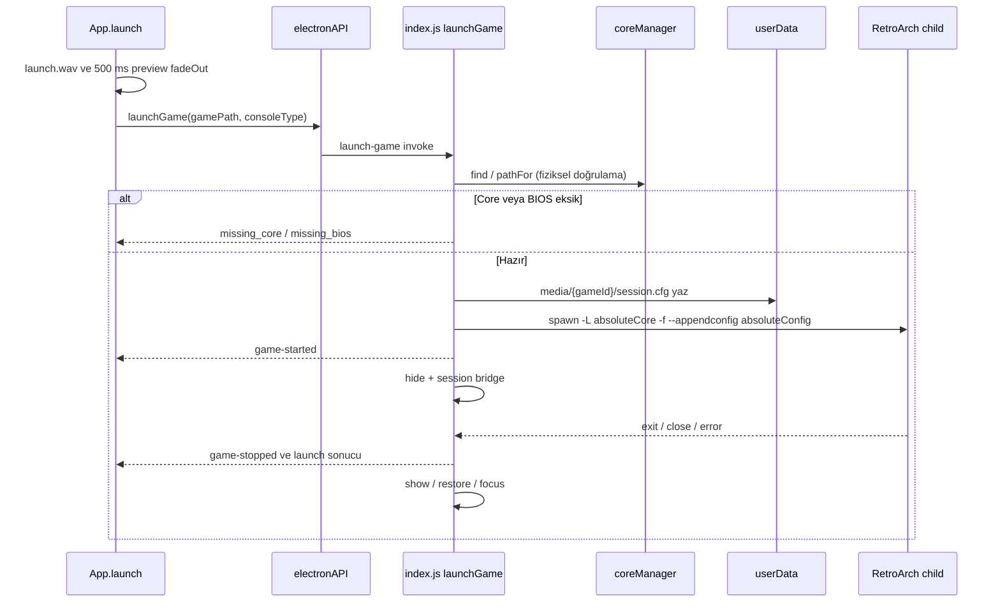

# Zenith OS — Teknik mimari ve katkı rehberi

Bu belge 2 Ekim 2026 tarihindeki kaynak ağacını açıklar. Tasarlanan gelecekteki
modüller ile çalışan kod birbirinden ayrılmıştır. Zenith bir Electron masaüstü
başlatıcısıdır; bağımsız bir çekirdek/işletim sistemi değildir. ROM, BIOS,
RetroArch kurulumu ve indirilen oyun medyası Git kaynak kod dağıtımının parçası değildir.
Üretim installer'ı RetroArch programını ayrı `extraResources` olarak içerir;
BIOS, ROM, çekirdek ikilileri (`cores/**`) ve kişisel çalışma verileri dahil edilmez.
Ana pencere çerçevesiz tam ekran açılır; kapatma ve oyun içi dönüş işlemleri Zenith
menüsü üzerinden yürütülür. Bu görsel konsol modu, işletim sistemi erişimini kilitleyen
bir güvenlik/kiosk politikası değildir.

## 1. Genel sistem mimarisi ve teknoloji yığını



| Katman    | Teknoloji / görev                                                                                                                             |
| --------- | --------------------------------------------------------------------------------------------------------------------------------------------- |
| Ana süreç | Electron 39; Node `fs`, `child_process`, `path`, `crypto`, `zlib`; pencere, IPC, dosya ve emülatör yaşam döngüsü.                             |
| Köprü     | Electron `contextBridge` ve dar uygulama köprüsü. Uygulama metotları Promise tabanlıdır.                                               |
| Renderer  | React 19, JavaScript/JSX; merkezi App state, küçük özel hook'lar; Redux/Zustand yok.                                                          |
| Derleme   | electron-vite 5; Vite 7 + React eklentisi; ana süreç, preload ve renderer ayrı çıktılar.                                                      |
| Stil      | Tailwind CSS 4, `@tailwindcss/postcss`; `main.css` içinde konsol stili ve değişkenler.                                                        |
| Paketleme | electron-builder 26; Windows x64 NSIS/portable, Linux x64 AppImage/deb.                                                                       |
| Emülasyon | Ayrı RetroArch süreci; Windows `.dll`, Linux `.so` libretro çekirdeği; uygulamaya gömülü emülasyon yok.                                       |
| Ses       | Vite ile paketlenen WAV → `new Audio()`; müzik/video → DOM `audio`/`video`. Web Audio API, AudioContext veya sentetik oscillator kullanılmaz. |

Sürümlerin tekrarlanabilir kaynağı `package-lock.json`'dır. `package.json` aralıkları
ile kurulu sürüm aynı şey değildir; `npm ci` kullanın. Bu ortamda Node 24.21.0,
Electron 39.8.10, Vite 7.3.6 ve React 19.3.0 ile doğrulandı.

### Güvenlik ve izolasyon sınırları

- `createWindow()` açıkça `contextIsolation: true`, `nodeIntegration: false`
  ayarlar. React doğrudan `fs`, `spawn` veya `require` kullanmaz.
- Preload ve renderer `sandbox: true` ile çalışır; worker Node entegrasyonu da kapalıdır.
- `window.electronAPI` uygulamanın dar amaçlı sözlüğüdür. `window.api = {}` boş
  şablondur. `window.electron` yalnız `process.versions` kopyasını sunar;
  genel IPC, ortam değişkenleri ve izolasyonsuz fallback kaldırılmıştır.
- `src/renderer/index.html` CSP'si uzak scriptleri engeller, görsel ve sesi
  `self`, `game-cover:`, `game-media:` kaynaklarından alır. Uzak HTML renderer'a
  yerleştirilmez. Dış bağlantılar Main `setWindowOpenHandler` → `shell.openExternal`
  yoluyla yalnız kimlik bilgisi içermeyen HTTP/HTTPS adresleri için açılır.
  Yeni pencere, belge/frame gezinmesi, yönlendirme, webview ve izin talepleri engellenir.
- Main oyun yolunu kütüphaneyle doğrular; çekirdek ismini renderer'dan bir komut
  veya URL olarak kullanmaz. Çekirdek seçiminde katalog/yerel kurulum üyeliği,
  dosya adı ve host uzantısı denetlenir. `spawn` shell açmaz.
- `game-media` yalnızca Main tarafından kayıt edilmiş URL/dosya eşleşmelerini
  sunar; renderer'ın keyfi `file://` yolu okuması için genel bir endpoint yoktur.
- Tüm Main IPC handler'ları gerçek ana pencerenin webContents, mainFrame ve
  beklenen belge URL'sini doğrular. Dosya gezgini yalnız izin verilen köklerde
  çalışır; yol ve realpath denetimi junction üzerinden dışarı çıkmayı da reddeder.
- Bu kontroller içeriğin lisansını veya BIOS'un gerçekliğini kanıtlamaz;
  yerel kullanıcıya karşı işletim sistemi düzeyinde bir güvenlik sınırı değildir.

### Pencere yaşam döngüsü ve çerçevesiz konsol modu

`src/main/index.js:createWindow`, `BrowserWindow` oluştururken
`fullscreen: true`, `kiosk: true`, `frame: false`, `autoHideMenuBar: true` kullanır.
`show: false` ilk boyama hazır olana kadar pencereyi gizler;
`ready-to-show` olayında `show()` çağrılır. 1440×800 boyutları tam ekran dışındaki
varsayılan pencere ölçüleridir; tam ekran içerik alanını ekran belirler.
Windows başlık çubuğu ve yerel büyüt/küçült/kapat kontrolleri çizilmez.
Geliştirme ve paketli sürüm aynı pencere seçeneklerini kullanır.

`contextIsolation: true`, `nodeIntegration: false`, preload yolu ve mevcut
`sandbox: true` ayarı kullanılır. Tam ekran için yeni IPC veya renderer yetkisi yoktur.
`Alt+F4`, işletim sistemi görev değiştirme ve sistem tuşları genel olarak engellenmez;
Electron kiosk modu etkin olsa da bu bir Windows güvenlik kilidi değildir. Escape/F10 veya yapılandırılmış
kombinasyon → ana menü → `quit-app` normal çıkış yoludur.

Emülatör başladığında `hide()` tam ekran özelliğini değiştirmez. Oturum menüsünde
`openSessionMenu` show/focus/always-on-top uygular; `resumeSession` tekrar gizler.
Child çıkışındaki idempotent `finish`, always-on-top'ı kaldırıp show/restore/focus
çağırır. Paketli runtime kopyalaması bu pencerenin açılmasını bekletmez.
`tests/runtime-startup.cjs` normal ve kritik kopyalama-hatası senaryolarında gerçek
pencerenin fullscreen durumunu, otomatik gizlenen menüyü ve içerik/dış sınırlarının
aynı olmasını doğrular. `tests/local-games.cjs` artık 1440 px'e bağlı sekiz sütun
varsaymak yerine kullanılabilir genişlikten poster kapasitesini ve dikey gezinmeyi sınar.

### Kaynak açıklamalarını okuma ve güncel tutma

Main servisleri, preload metotları, React bileşenleri, hook'lar ve yerel yardımcılar
üzerindeki İngilizce JSDoc blokları amaç, yan etki ve parametre sözleşmelerini açıklar.
Kritik ref/state ve yapılandırma açıklamaları sahiplik, eşzamanlılık ve neden ayrı
saklandıkları üzerine odaklanır. Effect açıklamaları abonelik/timer temizliğini ve
geç kalan yanıtların nasıl ele alındığını belirtir. JSON sözlüklerine yorum eklenmez;
JSON sözdizimini bozmak yerine i18n sözleşmesi hook ve bu belgede tutulur.

Bir davranış değişikliğinde fonksiyon açıklamasını, ilgili IPC satırını ve regresyon
testini birlikte güncelleyin. JSDoc bir çalışma zamanı doğrulaması değildir;
renderer'dan gelen değerler Main'de ayrıca doğrulanmalıdır. React callback'leri
bulundukları hook/bileşenin ref ve state'ini kapatır; cleanup eklemeden yeni bir
poller, ses oynatıcı veya global event dinleyicisi oluşturmayın.

## 2. Dosya ve klasör hiyerarşisi

Envanter uygulama kaynaklarını, yardımcıları, testleri ve yapılandırmayı kapsar.
`node_modules/`, `out/`, `dist/` üretilen/üçüncü taraf içeriktir; içlerindeki
kopya JavaScript dosyaları bağımsız Zenith modülleri değildir. Yerel `emulators/`
kurulumu da geliştirme bağımlılığıdır, katkı yapılacak kaynak ağacı değildir.

```text
zenith/
├── src/
│   ├── main/index.js
│   │   └── services/ (aşağıdaki servis envanteri)
│   ├── preload/index.js
│   ├── shared/{consoles,hotkeys}.js
│   └── renderer/
│       ├── index.html
│       └── src/{App.jsx,main.jsx,components/,hooks/,locales/,assets/}
├── resources/              uygulama ikonu ve native giriş köprüleri
├── scripts/                dağıtım koruması
├── tests/fixtures/         sentetik test verisi üreticileri
├── .githooks/              yerel pre-commit kontrolü
├── .github/workflows/      CI
├── .vscode/                editör/debug yapılandırması
├── build/                  paket ikonu ve macOS entitlement şablonu
├── games/                  yerel ROM'lar; Git ve dağıtım dışında
├── emulators/retroarch/    yerel runtime; Git dışında, seçili program dosyaları pakette
├── media/                  eski yerel klasör; indirmeler tarafından kullanılmaz
├── node_modules/           npm bağımlılıkları
├── out/                    Vite çıktısı
└── dist/                   builder çıktısı, oluştuğunda
```

### Ana süreç: tüm dosyalar

| Dosya                                | Birincil sorumluluk, süreçler ve dosya işlemleri                                                                                                                                                                                                                                                                                                                                                                                                                                    |
| ------------------------------------ | ----------------------------------------------------------------------------------------------------------------------------------------------------------------------------------------------------------------------------------------------------------------------------------------------------------------------------------------------------------------------------------------------------------------------------------------------------------------------------------- |
| `src/main/index.js`                  | Composition root. `createWindow`, `getLocalGames`, `decorateGame`, `guideGame`, `uploadBios`, `openBiosFolder`, `launchGame`, `openSessionMenu`, `resumeSession`; tüm IPC kayıtları ve iki özel protokol. ROM dizinini oluşturur/okur; ROM ve BIOS silme/kopyalama, tercih JSON'u, session.cfg, saves/states oluşturma. RetroArch child ve native bridge yaşam döngüsünün sahibidir. `launchInProgress`, `activeChild`, `sessionMenuOpen`, `deleting` eşzamanlı işlemleri sınırlar. |
| `src/main/services/platform.js`      | `runtimePaths`, `pathKey`: Windows portable/kurulu/geliştirme ve Linux yolları. Windows karşılaştırmasını küçük harfe normalize eder; Linux case-sensitive kalır. Süreç başlatmaz.                                                                                                                                                                                                                                                                                                  |
| `src/main/services/gameImporter.js`  | `createGameImporter`: Promise kuyruğuyla asenkron merkezi kopyalama; geçici `.import-UUID.part`, exclusive hedef yayınlama, isim çakışmasında numaralandırma. PSP yol ipucunu ISO adına taşır. Kaynak dosyayı silmez. ZIP/7z açmaz, CUE/GDI yan dosyalarını kendiliğinden kopyalamaz.                                                                                                                                                                                               |
| `src/main/services/libraryStore.js`  | `library.json` yükle/kaydet; `add`, `remove`, `list`, `excluded`. Merkezi kopyaları ve eski dış referansları tutar, yolları tekilleştirir. Senkron JSON `.tmp`/rename kullanır. `games.json` medya manifestiyle karıştırılmamalıdır.                                                                                                                                                                                                                                                |
| `src/main/services/scraper.js`       | `cleanGameName`, `gameMediaId`, `createScraper`. Libretro Named_Boxarts/Snaps/Titles kataloglarından eşleşen PNG; yerel kapak önceliği, userData manifesti, güncelleme/progress callback'leri. `scan`, `enrich`, `forget`, `whenMediaIdle`; silinen oyunun geç gelen indirmeyle geri yazılmasını önler.                                                                                                                                                                             |
| `src/main/services/mediaScraper.js`  | Archive.org ses/video arama, metadata eşleştirme ve stream indirme. `theme.mp3`/`preview.mp4`, 15 sn timeout, 5 MiB sınır; ayrı başarısızlık/cooldown, redirect allowlist, imza doğrulaması ve `.part` temizliği. KHInsider/Zophar kullanılmaz.                                                                                                                                                                                                                                     |
| `src/main/services/mediaPaths.js`    | `mediaRoot`, `gameMediaDirectory`: absolute userData zorunlu; oyun ID'si `[a-z0-9-]`, en fazla 151 karakter. Verilen keyfi mediaDirectory'yi hedef kabul etmez.                                                                                                                                                                                                                                                                                                                     |
| `src/main/services/local-media.js`   | `mediaUrl`, `serveMedia`, `revokeMediaDirectory`: SHA-256 anahtarlı runtime URL tablosu; GET/HEAD, byte range/suffix range, MIME ve 416/404 davranışı. Akışla servis eder; tüm videoyu belleğe almaz.                                                                                                                                                                                                                                                                               |
| `src/main/services/guideService.js`  | Wikipedia REST lore ve Archive.org videogamemanuals/BookReader metadata/sayfaları. `getLore`, `getManual`, `getPage`, `getFeatures`, `setFeatures`, `whenIdle`. 10 sn, JSON 2 MiB/sayfa JPEG 8 MiB, en fazla 512 sayfa; local lore/manual cache ve eşzamanlı istek tekilleştirme.                                                                                                                                                                                                   |
| `src/main/services/biosStatus.js`    | `BIOS_RULES`, `biosDirectory`, `biosStatus`, `deleteBios`. PS2, PS1, Dreamcast ad/boyut denetimi; yalnızca ilgili BIOS adaylarını kaldırır, system dizininin tamamını silmez. Süreç/ağ yok.                                                                                                                                                                                                                                                                                         |
| `src/main/services/coreManager.js`   | `CORE_FILES`, `coreFilesFor`, `buildbotBase`, `extractCore`, `createCoreManager`. `find`, `pathFor`, `install`, `installNamed`; resmi x64 Buildbot ZIP'i, CRC ve Windows PE/Linux ELF64 kontrolü; 120 sn/200 MiB sınır. `installedCorePath` fiziksel, okunabilir ve doğru host başlığına sahip dosyayı doğrular; geçerli dosya yeniden indirilmez, bozuk/boş dosya atomik olarak yenilenir. Aynı dosya listesi kurulumları tekilleşir.                                              |
| `src/main/services/coreCatalog.js`   | `createCoreCatalog`, `biosPlatformForCore`: hosta uygun tüm Buildbot core dosyalarını listeler, kurulu core'ları birleştirir, alfabetik ad/arama alias'ları üretir. 10 sn/2 MiB, 1 saat RAM cache, userData disk fallback. `list`, `allowed`, `get`, `select`, `forget`; oyun veya platform bazında çekirdek tercihi. BIOS isteyen bilinen core ailesini seçilen dosya adından da tanır.                                                                                            |
| `src/main/services/sessionBridge.js` | `startSessionBridge`: Windows PowerShell veya Linux Python child process. Sayısal PID ve doğrulanmış hotkey JSON'unu stdin'den geçirir; stdout `home` satırını callback'e dönüştürür. `update`, `resume`, `stop`; parçalı stdout satırlarını tamponlar, stderr loglar. Linux script yolunu `app.asar.unpacked` fiziksel yoluna dönüştürür.                                                                                                                                          |

`retroarchProcess.js`, `libraryScanner.js` ve `windowManager.js` isimli dosyalar
mevcut değildir; bu sorumluluklar bugün `index.js` içindedir. `bgm.js` yerine
`mediaScraper.js`, `guideService.js` dışında ayrı `loreScraper.js` yoktur.

### Preload ve paylaşılan model

| Dosya                    | Sorumluluk                                                                                                                                                                                                                                                                               |
| ------------------------ | ---------------------------------------------------------------------------------------------------------------------------------------------------------------------------------------------------------------------------------------------------------------------------------------- |
| `src/preload/index.js`   | Uygulama invoke metotları ve unsubscribe döndüren event abonelikleri. Tam metot/parametre listesi bölüm 3'tedir. `window.api` boş, `window.electronAPI` gerçek uygulama API'si, `window.electron` yalnız sürüm bilgisi içerir.                                                                    |
| `src/shared/consoles.js` | Konsol–uzantı tablosu ve iki dosya seçici filtresi. Importer, scanner, library ve renderer aynı tabloyu kullanır. Saf isim/uzantı ipuçları; Main discInspector ve kalıcı oyun seçimi nihai platformu belirler. SMD→Genesis, V64→N64, A26/A78/LNX→Atari; BIN/ROM/ATX/ZIP/7z `Unassigned`. |
| `src/shared/hotkeys.js`  | Varsayılan `[8,9]`, klavye default `[]` (Esc/F10); tuş adı/Windows sanal kod dönüşümü, farklı iki tuş doğrulaması ve `createGamepadHotkey`. Modalda tüketilen basışın bırakılma eylemini ana ekrana sızdırmaz.                                                                           |

### Renderer girişleri ve tüm bileşenler

| Dosya                             | Props, state ve görev                                                                                                                                                                                                                                                                                              |
| --------------------------------- | ------------------------------------------------------------------------------------------------------------------------------------------------------------------------------------------------------------------------------------------------------------------------------------------------------------------ |
| `src/renderer/index.html`         | CSP, root DOM ve Vite giriş modülü.                                                                                                                                                                                                                                                                                |
| `src/renderer/src/main.jsx`       | `main.css`, React StrictMode, `I18nProvider`, App mount.                                                                                                                                                                                                                                                           |
| `src/renderer/src/App.jsx`        | Props yok. `currentIndex`, konsol filtresi, arama/draft, OSK, guide, panel, busy/notice/error, launchState, previewEnabled. Kütüphane hook'u, input routing, hero/grid/footer ve ana modal içerikleri burada. `MainLayout`, `GameCard`, `SettingsModal`, `FilterModal`, `GameOptionsModal` ayrı dosyalar değildir. |
| `components/ConsoleModal.jsx`     | `{title,children,onClose,busy,kind}`; native dialog showModal/focus restore, option index ve remembered index ref'leri; 2D filtre veya 1D kontrol listesi, dropdown/hotkey/core-search event yönlendirmesi. `data-controller-focused` mavi çerçeveyi DOM focus kaybolsa da taşır.                                  |
| `components/ConsoleDropdown.jsx`  | `{label,value,options,onChange}`; open/index, dil listesinde A aç/uygula, B kapat, up/down sınırda durur. Dil state'i parent'tadır.                                                                                                                                                                                |
| `components/SystemSettings.jsx`   | `{preferences,togglePreference,saveHotkeys,playSound,systemPage,onOpenSystems,onDeleteBios,onBrowseCores}`; systems/busy/message. Dil, iki ses switch'i, hotkey editor; alt sayfada yalnızca kütüphanede görülen konsollar, core/BIOS durumları, indirme/Gözat/silme/yükleme.                                      |
| `components/HotkeySetting.jsx`    | `{hotkeys,onSave}`; editing `{device,keys}`, error, saving ref. İki aşamalı dinleme, aktif cihaz rozetleri, B/Esc iptal, Promise başarılıysa kalıcı tercih.                                                                                                                                                        |
| `components/CoreBrowser.jsx`      | `{onSelect,busy}`; catalog/query/filter/keyboard. `listCores()`; 150 ms debounced canlı ad+dosya adı araması. X veya arama alanında A ile OSK; her onChange listede uygulanır. Seçim parent'ın install/select/launch akışına gider.                                                                                |
| `components/OnScreenKeyboard.jsx` | `{value,onChange,onClose}` kontrollü metin; TR/EN layout, symbols, 2D position, caret/selection, editing. iOS üç harf satırı, Backspace ve alt fonksiyon satırı. String'in seçilen bölümünü değiştirir; B/Menu/Done kapatır. Ayrı VirtualKeyboard dosyası yok.                                                     |
| `components/GuideDrawer.jsx`      | `{game,onClose}`; lore/manual/features/loading, tab/page/pageResult, page-cache ve scroll ref. İki sekme, LB/RB sınırlandırılmış, right-stick/dikey D-pad scroll, yatay sayfa çevirme; remote HTML göstermez.                                                                                                      |
| `components/InputHint.jsx`        | `InputHint({keyboard,gamepad,children})`, `KeyBadge({keyboard,gamepad})`; InputContext'e göre keyboard veya renkli Xbox rozeti. Yerel state yok.                                                                                                                                                                   |
| `components/Versions.jsx`         | Şablon kalıntısı; props yok, preload'dan versions state'i. Aktif dashboard tarafından import edilmez.                                                                                                                                                                                                              |

### Renderer hook'ları, state ve varlıklar

| Dosya                                                    | API ve davranış                                                                                                                                                                                                                                                                                                                                        |
| -------------------------------------------------------- | ------------------------------------------------------------------------------------------------------------------------------------------------------------------------------------------------------------------------------------------------------------------------------------------------------------------------------------------------------ |
| `hooks/useController.js`                                 | `useController(onFrame)` → `{mode,modeRef,controller}`. Tek `requestAnimationFrame` döngüsü, sabit 60 Hz garanti edilmez. İlk bağlı kol, axis deadzone 0.25, yön eşiği 0.5; ilk repeat 350 ms, sonra 150 ms. `hit`, `released`, `buttons`, `axes`, `move`, `now`, `inputMode`. Pil bilgisi varsa normalize eder; standart API'de pil zorunlu değildir. |
| `hooks/inputContext.js`                                  | Rozetler ve giriş modunun React context tanımı.                                                                                                                                                                                                                                                                                                        |
| `hooks/useGridColumns.js`                                | Eski çok satırlı grid için sütun ölçüm yardımcısı; ana dashboard artık bunu kullanmaz. Carousel ResizeObserver doğrudan App içinde seçili kartı görünür tutar.                                                                                                                                                                                                                    |
| `hooks/useGameLibrary.js`                                | games/loading/error/scanning/progress/warning, `refresh(force)`, `removeFromState`. Önce yerel oyunları gösterir, sonra scrape eder. Geç gelen music/video event'lerini hızlı/yavaş artwork güncellemelerinin üzerine korur; mount/unmount abonelik temizliği.                                                                                         |
| `hooks/useMediaPreview.js`                               | `(game,enabled,sound)` → videoRef/audioRef/cinematic/stop/fadeOut/restart. 800 ms bekleme, 400 ms fade-in, maks 0.3 volume; karttan ayrılınca audio 150 ms fade-out, video reset. Launch fade 500 ms. Blur/visibility/unmount timer, rAF ve medya cleanup.                                                                                             |
| `hooks/useSoundEffects.js`                               | `(enabled)` → `play`; ayrıca `emitSound(name)`. WAV import'ları ve soundPool.js yaşam döngüsü; navigate altı önceden yüklenmiş voice, throttle yok, doluysa en eski kanal kullanılır. Toggle/launch ikişer voice; navigate/toggle mute, launch bağımsız.                                                                                                          |
| `hooks/usePreferences.js`                                | preferences/togglePreference/saveHotkeys. Menü sesi ve önizleme sesi boolean; hotkeys normalize. localStorage `zenith-preferences`; native hotkey dosyasıyla hydrate/senkronizasyon.                                                                                                                                                                   |
| `hooks/useClock.js`                                      | Sistem HH:mm, h23; 1000 ms interval cleanup; locale formatı tr-TR.                                                                                                                                                                                                                                                                                     |
| `hooks/i18n.jsx`                                         | `I18nProvider({children})`, `useI18n()` → language/setLanguage/t. Default en, fallback en/key, HTML lang güncelleme ve `zenith-language` localStorage.                                                                                                                                                                                                 |
| `hooks/useBiosManager.js`                                | Eski tekrar kullanılabilir hook `(onClose)`; platform/dialogRef/busy/error/notice ve show/close/upload/openFolder. Aktif App BIOS UI'si bunu kullanmaz, App.run üzerinden çalışır.                                                                                                                                                                     |
| `locales/en.json`, `locales/tr.json`                     | Arayüz sözlükleri; teknik/native servis hatalarının tamamı henüz çevrilmiş değildir.                                                                                                                                                                                                                                                                   |
| `assets/main.css`                                        | Tailwind import, Xbox rozetleri, vignette, 144×216 poster, gap16, responsive iki satırlı grid, dikey odak geçişi, ince scrollbar, modal/OSK/drawer stili.                                                                                                                                                                                                             |
| `assets/base.css`                                        | Electron/Vite şablon renk/font temel stili; güncel main.jsx bunu import etmez.                                                                                                                                                                                                                                                                         |
| `assets/electron.svg`, `assets/wavy-lines.svg`           | Kullanılmayan şablon varlıkları; telif/lisans envanteri açısından yine kaynak varlığı sayılır.                                                                                                                                                                                                                                                         |
| `assets/sounds/navigate.wav`, `toggle.wav`, `launch.wav` | Kullanıcı tarafından sağlanan üç UI sesi. Vite bundle asset'leri; Git'te dar istisna. navigate ve toggle aynı byte içeriğindeyse Vite tek output dosyasını paylaşabilir.                                                                                                                                                                               |

Renderer'da ayrı `services/`, `store/` veya `context/` klasörü yoktur. Context'ler
hooks altında; iş verisi React state ve Main JSON dosyalarında bulunur. Paketlenen
özel font yoktur; CSS sistem fontlarını kullanır.

### Native yardımcılar, kök yapılandırma ve testlerin tam envanteri

| Dosya                                                                                 | Görev                                                                                                                                                                                                                 |
| ------------------------------------------------------------------------------------- | --------------------------------------------------------------------------------------------------------------------------------------------------------------------------------------------------------------------- |
| `resources/gamepad-bridge.ps1`                                                        | Windows XInput/GetAsyncKeyState: 20 ms polling, emulator foreground + 500 ms grace, validated Zenith HWND/PID activation. stdin: JSON pad/keys/zenithWindow/zenithPid, focus-zenith/resume/stop; stdout: home.        |
| `resources/gamepad-bridge.py`                                                         | Python stdlib ctypes → sistem SDL2/X11; 30 ms polling. Linux gamepad background hint, X11 keymap, /proc/PID yaşam kontrolü; Python/SDL2 yoksa yardımcı çalışmayabilir, Wayland eşdeğeri yok.                          |
| `resources/icon.png`                                                                  | Electron pencere/Linux ikonu.                                                                                                                                                                                         |
| `build/icon.png`, `build/icon.ico`, `build/icon.icns`, `build/entitlements.mac.plist` | Builder kaynakları ve şablon macOS entitlement. Bunlar runtime oyun medyası değildir; dağıtım hakları yine doğrulanmalıdır.                                                                                           |
| `scripts/check-distribution.mjs`                                                      | Git indeksini inceler; ignored/runtime yolları ve şüpheli binary magic/2 MiB'den büyük staged blob'ları reddeder. Uygulama ikonları/şablon SVG/üç WAV dar allowlist. Commit geçmişini veya medya lisansını incelemez. |
| `.githooks/pre-commit`                                                                | Dağıtım kontrolünü commit öncesinde çalıştırır; clone sonrası ayrıca etkinleştirilir.                                                                                                                                 |
| `.github/workflows/ci.yml`                                                            | Push/PR verify: windows-latest + Node 22; npm ci, dağıtım kontrolü, lint, Node testleri, Vite build. Installer veya Electron UI testi çalıştırmaz; yayın/deploy yok.                                                  |
| `package.json`, `package-lock.json`                                                   | Komutlar, bağımlılıklar ve kilitli çözümleme.                                                                                                                                                                         |
| `electron.vite.config.mjs`                                                            | Main/preload/renderer build; `@renderer` alias'ı, React plugin. `@/` alias'ı tanımlı değildir.                                                                                                                        |
| `electron-builder.yml`                                                                | ASAR uygulama allowlist’i; extraResources ile RetroArch; kişisel runtime verilerinin dışlanması; beforePack doğrulaması; platform hedefleri. Publish URL/author şablondur, release öncesi düzenlenmelidir.            |
| `eslint.config.mjs`, `.prettierrc.yaml`, `.prettierignore`, `.editorconfig`           | Lint/format/editor sözleşmesi.                                                                                                                                                                                        |
| `postcss.config.js`, `tailwind.config.js`                                             | PostCSS/Tailwind yapılandırması; Tailwind4 giriş noktası main.css'tir.                                                                                                                                                |
| `.gitignore`                                                                          | Dinamik dosyalar, BIOS/core/ROM/disk/medya, tüm emulators ağacı; büyük-küçük harf varyantlarını da kapsar.                                                                                                            |
| `.vscode/extensions.json`, `.vscode/settings.json`, `.vscode/launch.json`             | Önerilen eklentiler/ayarlar; main ve renderer için debug/9222 compound.                                                                                                                                               |
| `README.md`, `ARCHITECTURE.md`                                                        | Kullanıcı/kurulum rehberi ve bu geliştirici sözleşmesi.                                                                                                                                                               |
| `tests/fixtures/core-archive.cjs`                                                     | Sentetik ZIP + PE/ELF fixture üretir; gerçek çekirdek içermez.                                                                                                                                                        |
| `tests/console-services.test.mjs`                                                     | ZIP/core fallback/kurulum, library persistence, BIOS teşhis/silme.                                                                                                                                                    |
| `tests/core-catalog.test.mjs`                                                         | Katalog origin/path filtreleme, offline cache, seçim/silme, Atari eşlemeleri ve named kurulum.                                                                                                                        |
| `tests/guide.test.mjs`                                                                | Mock Wikipedia/Archive eşleşme, timeout, sayfa/cache/feature davranışı.                                                                                                                                               |
| `tests/import-hotkeys.test.mjs`                                                       | Merkezi kopya, çakışma, genişletilmiş formatlar, native tuş doğrulama ve chord sızıntısı.                                                                                                                             |
| `tests/media-paths.test.mjs`                                                          | userData confinement, sahte hedef reddi, Git ignore büyük/küçük harf kuralları.                                                                                                                                       |
| `tests/platform.test.mjs`                                                             | Linux/Windows path, ELF/PE ve BIOS case davranışı.                                                                                                                                                                    |
| `tests/scraper.test.mjs`                                                              | Libretro üç görsel, Archive ses/video, akış limitleri, timeout, cache/yarışlar ve range.                                                                                                                              |
| `tests/local-games.cjs`                                                               | Gizli Electron: klasör/tarama/kapak, konsol filtreleri ve gezinme, boş/hata durumları.                                                                                                                                |
| `tests/launcher.cjs`                                                                  | Electron launch/spawn argümanları, PSP/PS2 fallback, süreç hatası/restore.                                                                                                                                            |
| `tests/bios.cjs`                                                                      | Electron IPC/BIOS modalı, upload/folder/delete ve launch engeli.                                                                                                                                                      |
| `tests/media.cjs`                                                                     | IPC medya güncellemesi, gerçek DOM audio/video mock, debounce/fade/range/cleanup.                                                                                                                                     |
| `tests/guide.cjs`                                                                     | Drawer sekme, gamepad scroll, manual sayfaları ve ağ boş durumları.                                                                                                                                                   |
| `tests/controller.cjs`                                                                | Pil/saat/mod, D-pad/analog, options focus ve OSK arama/focus trap.                                                                                                                                                    |
| `tests/console-os.cjs`                                                                | Dil/audio/sistemler, merkezi import/delete, launch/core/session; --screenshot ile 1920/1280/1024 responsive layout.                                                                                                   |
| `tests/hotkeys.cjs`                                                                   | Remap, iptal/persistence, native bridge mesajları, Quick Menu config, app quit double'ları.                                                                                                                           |
| `tests/core-browser.cjs`                                                              | Atari missing-core, Gözat listesi, Done beklemeden OSK filtreleme, D-pad ile seçim, kurulum/launch ve kalıcı oyun tercihi.                                                                                            |

Ek dağıtım regresyonu: `tests/distribution.test.mjs`, ayrı geçici Git deposunda
zorla eklenen ROM uzantıları ve yeniden adlandırılmış EXE imzasının commit guard
tarafından reddedildiğini doğrular.

### Envantere dahil ek doğrulama dosyaları

| Dosya                                                     | Doğruladığı sözleşme                                                                                               |
| --------------------------------------------------------- | ------------------------------------------------------------------------------------------------------------------ |
| `tests/core-verification.test.mjs`                        | Fiziksel core denetimi, diskten silinince Missing, CRC/başlık/yazma hataları ve Windows Zone.Identifier temizliği. |
| `tests/core-download.cjs`                                 | Paketli runtime hedefi, gerçek Main/Preload/UI, hata bildirimi ve indirme hedefinin mutlak -L yoluyla eşitliği.    |
| `tests/bundled-runtime.test.mjs`                          | Artımlı kopyalama, kilitli opsiyonel CFG, kritik dosya hatası ve yarım dosya onarımı.                              |
| `tests/runtime-startup.cjs`                               | Fullscreen/frameless pencere açılışı, kopyalama beklerken çalışan IPC ve kritik hatada açık kalan pencere.         |
| `tests/emulator-bootstrap.test.mjs`                       | Resmi kararlı sürüm seçimi, sentetik 7z çıkarma, yol/link sınırı ve paket önkontrolü.                              |
| `scripts/nsis-process.cjs`, `tests/nsis-process.test.mjs` | Sınırlı Windows spawn adaptörü, ortam koruması, tekrar politikası ve NSIS sihirbaz ayarları.                       |

`scripts/setup-emulators.mjs`, `scripts/validate-emulators.cjs` ve
`src/main/services/bundledRuntime.js` ayrıntıları bölüm 7'dedir. Bu dosyalar aynı
işlemi yapmaz: geliştirici indirir, builder yerel runtime'ı doğrular, son kullanıcı
uygulaması paketlenmiş programı yazılabilir profile kopyalar.

## 3. IPC sözlüğü

Tüm uygulama istekleri `src/main/index.js` içinde `ipcMain.handle`, preload'da
`ipcRenderer.invoke` ile tanımlıdır. Tablodaki metotların kökü **window.electronAPI**.
`Result` genel olarak `{success:boolean,error?:string,canceled?:boolean}`.
Her invoke bir Promise döndürür; tabloda Promise'ın çözümlenen değeri yazılıdır.

| Kanal                   | Preload metodu / payload                                      | Dönen değer                                                  | İşlem / hata davranışı                                                                                                                                                      |
| ----------------------- | ------------------------------------------------------------- | ------------------------------------------------------------ | --------------------------------------------------------------------------------------------------------------------------------------------------------------------------- |
| `get-local-games`       | `getLocalGames()`                                             | `Game[]`                                                     | Dizini oluşturur/tarar, library ile birleştirir, deleting oyunları çıkarır. FS hatası Promise reject; hook yakalar.                                                         |
| `add-games`             | `addGames(tokens)`                                                  | Result + `count`                                             | Dahili gezgin tokenlarını doğrulama, central async copy, library.add; FS hatası Result.error.                                                                                  |
| `delete-game`           | `deleteGame(gameId)`                                          | Result                                                       | Kütüphane ID doğrulama, launch kilidi, ROM/cache/kayıt temizliği. Renderer silinecek path gönderemez.                                                                       |
| `scan-and-scrape-games` | `scanAndScrapeGames({force?:boolean}={})`                     | `{games,warning}`                                            | Ortak scan Promise; progress/media olayları. Ağ opsiyoneldir; okunabilir yerel kütüphane korunur.                                                                           |
| `launch-game`           | `launchGame(gamePath,consoleType)` → `{gamePath,consoleType}` | Result; missing_core/missing_bios + `platform`, BIOS details | Oyun üyeliği, exe/core/BIOS, spawn. Başarılı invoke **süreç kapanana kadar** pending kalır; başlangıç ayrı event'tir.                                                       |
| `install-core`          | `installCore(platform)`                                       | Result + `core`                                              | Varsayılan core/fallback kurulumu. Unsupported platform Result.error; browser kullanılabilir.                                                                               |
| `list-cores`            | `listCores()`                                                 | `{success,cores:[{fileName,name,installed}],offline,error?}` | Resmi host kataloğu + local kurulum, alfabetik; ağ kesilince cache/local sonuç.                                                                                             |
| `select-core`           | `selectCore({gameId?,platform?,core})`                        | Result + `core`                                              | Gerçek oyun ID veya bilinen platform; Unassigned için oyun ID şart. Katalogda/yerelde olmayan ad reddedilir. Kurulumdan sonra tercih saklanır; IPC doğrudan oyun başlatmaz. |
| `get-system-status`     | `getSystemStatus()`                                           | `[{platform,core,corePath,coreDirectory,bios}]`              | Kütüphanedeki platformlar, platform tercihi veya default kurulu core, BIOS durumu. Oyun bazlı override her sistem satırında gösterilmez.                                    |
| `upload-bios`           | `uploadBios(platform)`                                        | Result + `fileName,status`                                   | Native bin/rom seçimi, doğru hedefe exclusive copy; aynı adlı dosya üzerine yazılmaz, canceled desteklenir.                                                                 |
| `delete-bios`           | `deleteBios(platform)`                                        | Result + `status`                                            | Aktif oyun varsa engel; yalnız bu platformun aday BIOS dosyaları.                                                                                                           |
| `open-bios-folder`      | `openBiosFolder(platform)`                                    | Result                                                       | mkdir + shell.openPath; shell hata metni Result.error.                                                                                                                      |
| `get-runtime-info`      | `getRuntimeInfo()`                                            | `{platform,retroarchDir,gamesDirectory}`                     | Platforma göre çözümlenmiş gerçek yollar.                                                                                                                                   |
| `show-session-menu`     | `showSessionMenu()`                                           | `{success:!!activeChild}`                                    | Native pencereyi öne alır ve session-menu yayar; zaten açıksa yeniden açmaz.                                                                                                |
| `resume-session`        | `resumeSession()`                                             | Result                                                       | Aktif child varsa always-on-top kapat, hide, bridge resume.                                                                                                                 |
| `stop-session`          | `stopSession()`                                               | `{success:true}`                                             | Varsa child.kill; exit callback pencere/state temizliğini yürütür.                                                                                                          |
| `quit-app`              | `quitApp()`                                                   | `{success:true}`                                             | Varsa child.kill, app.quit. Uygulama kapandığı için renderer dönüşü her zaman göremeyebilir.                                                                                |
| `get-hotkeys`           | `getHotkeys()`                                                | `{gamepad:number[2],keyboard:string[]}`                      | Diskten başlangıçta yüklenen normalize runtime tercihi.                                                                                                                     |
| `save-hotkeys`          | `saveHotkeys(hotkeys)`                                        | Result + `hotkeys`                                           | userData JSON `.tmp`/rename; çalışan bridge'e update. Hata Result.error.                                                                                                    |
| `get-guide-features`    | `getGuideFeatures()`                                          | `{manualsEnabled,loreEnabled}`                               | Servis flags; setFeatures servis API'si var, renderer'a ayar yazma IPC'si henüz yok.                                                                                        |
| `get-game-lore`         | `getGameLore(gameId)`                                         | `{summary,year,developer,sourceTitle,sourceUrl}` veya null   | Kütüphaneden resolve; cache/Wikipedia. Eşleşme/ağ/parse hatasında null.                                                                                                     |
| `get-game-manual`       | `getGameManual(gameId)`                                       | `{title,pageCount,sourceUrl}` veya null                      | Cache/Archive metadata; tam internal leaf listesi renderer'a gönderilmez.                                                                                                   |
| `get-manual-page`       | `getManualPage(gameId,index)` → `{gameId,index}`              | URL string veya null                                         | İndeks sınırı, JPEG cache/download, game-media URL. Hata null.                                                                                                              |

`import-game`, `check-bios`, `download-core` isimli alternatif kanallar yoktur.
Bunların karşılıkları sırasıyla add-games, get-system-status/launch-game ve
install-core/select-core'dur. Uygulamada `ipcMain.on` ile ayrı request kanalı yoktur.

### Preload'un sınırlı ek yüzeyi

`window.electron.process.versions` yalnız sürüm göstergesi için düz bir kopyadır.
Genel `ipcRenderer`, `webFrame`, `webUtils` veya `process.env` expose edilmez.
Uygulama işlemleri yalnız `window.electronAPI` içindeki sabit kanallı metotlardan
geçer; abonelikler Electron event nesnesini renderer'a aktarmadan unsubscribe döndürür.

### Main → Renderer olayları

| Kanal                | Preload aboneliği              | Payload / kullanım                                                                |
| -------------------- | ------------------------------ | --------------------------------------------------------------------------------- |
| `game-started`       | `onGameStarted(callback)`      | Payload yok; launchState running olur.                                            |
| `game-stopped`       | `onGameStopped(callback)`      | Payload yok; launch/session state sıfırlanır; hata diyaloğunda da gönderilebilir. |
| `session-menu`       | `onSessionMenu(callback)`      | boolean; oyun içi modal aç/kapat.                                                 |
| `scrape-progress`    | `onScrapeProgress(callback)`   | `{completed,total,game,warning?}`; kart ve ilerleme güncellemesi.                 |
| `game-media-updated` | `onGameMediaUpdated(callback)` | Güncel Game; music/video download tamamlanınca canlı güncelleme.                  |

Her abonelik **unsubscribe fonksiyonu** döndürür. useEffect cleanup'ta çağırın;
callback'e Electron event nesnesi expose edilmez.

### IPC olmayan iç olaylar ve protokoller

`controller-input` en üstteki açık dialog'a dispatch edilir. ConsoleModal bunu
`controller-dropdown`, `controller-hotkey`, `controller-core-search` alt olaylarına
yönlendirebilir. `zenith-sound` bir DOM CustomEvent'tir. Native helper stdin
JSON `{pad,keys}` ile `resume`/`stop` satırları alır, stdout `home` üretir.
`game-cover://local/...` aynı dizindeki kullanıcı kapağını; `game-media://local/...`
izin tablosuna alınmış cache dosyasını sunar. Bunlar invoke kanalı değildir.

## 4. Veri yerleşimi ve kritik yaşam döngüleri

### Veri sözleşmesi ve kalıcılık

Game temel alanları: `id,title,fileName,path,system,systemShort,cover,backdrop`.
Enrichment: `gameId,region,year,developer,genre,media,mediaDirectory`; renderer
URL'leri `coverUrl,backdropUrl,titleScreenUrl,musicUrl,videoUrl`. ID, platform + temiz ad slug'ı +
SHA-256'nın 12 hex karakterinden oluşur; eski import kayıtlarında importKey de hash'e girer.
Yıl/geliştirici/tür scraper'da null kalabilir; Wikipedia lore ayrı önbellektir,
her metadata alanının otomatik dolduğu varsayılmamalıdır.

| Yer                                                           | İçerik                                                                                                                                                                |
| ------------------------------------------------------------- | --------------------------------------------------------------------------------------------------------------------------------------------------------------------- |
| Windows geliştirme kökü                                       | `games/`, `emulators/retroarch/{retroarch.exe,cores/,system/}`.                                                                                                       |
| Windows packaged                                              | Oyun kökü portable env veya executable dizinidir. RetroArch ilk açılışta resources'tan userData/emulators/retroarch altına hazırlanır; cores/BIOS burada yazılabilir. |
| Linux                                                         | games daima userData/games; development emülatörü proje kökünde, packaged emülatör userData/emulators/retroarch altında.                                              |
| userData/library.json                                         | Imported paths ve excluded paths.                                                                                                                                     |
| userData/games.json                                           | Scraper metadata/media manifesti; ROM dosyası burada değildir.                                                                                                        |
| userData/zenith-preferences.json                              | Native hotkeys; diğer renderer tercihleri localStorage'dadır.                                                                                                         |
| userData/core-catalog-win32.json veya core-catalog-linux.json | Çekirdek dosya adı cache'i.                                                                                                                                           |
| userData/core-selections.json                                 | `game:<gameId>` veya `platform:<system>` → core dosya adı.                                                                                                            |
| userData/media/{gameId}/                                      | boxart.png, snap.png, title.png, theme.mp3, preview.mp4, lore.json, manual metadata/pages, session.cfg, saves/, states/.                                              |
| localStorage                                                  | zenith-preferences (ses/hotkeys), zenith-language, zenith-keyboard.                                                                                                   |

İndirilen oyun medyası proje köküne yazılmaz. Eski userData/media/music ve videos
yolları geriye uyumlu okunabilir; proje kökündeki media klasörü download hedefi değildir.

### 4.1 Oyun ekleme



`App.addGames → useFilePicker → FileBrowser → files:list → electronAPI.addGames(tokens) → importGames → library.add`.
Başarıdan sonra `refresh(false)` ilk taramayı ve artwork scraping'i başlatır.
Kopya sırasında UI process bloklanmaz. Kaynak aynı merkezi klasördeyse yeniden
kopyalanmaz. Harici orijinal silinse de merkezi kopya kalır. Çok dosyalı CUE/GDI
oyunlarının yan dosyaları için otomatik paket import henüz yoktur; importer yalnız
seçilen dosyaları kopyalar. Arcade romset isim çakışmasında numaralandırma
uyumluluğu bozabilir; böyle setleri isimlerini koruyarak yönetin.

### 4.2 Başlatma, askıya alma ve çıkış

1. `App.launch` launchBusyRef'i kilitler; `playSound('launch')` ve
   `fadeOut()` önizlemeyi 500 ms kısar. UI starting animasyonuna geçer.
2. `launchGame` Main'de exe çalıştırılabilirliğini, kayıtlı yol/platform üyeliğini,
   oyun/platform core override'ını veya default core'u ve BIOS'u denetler.
3. userData oyun dizininde saves/states ve session.cfg yazılır. Overrides:
   `pause_nonactive=true`, `config_save_on_exit=false`,
   `input_menu_toggle_gamepad_combo="0"`, `input_menu_toggle_btn="nul"`,
   `input_menu_toggle="nul"`, `input_exit_emulator="nul"`,
   `input_quit_gamepad_combo="0"`, system/save/state dizinleri.
4. `spawn(executable,['-L',corePath,gamePath,'-f','--appendconfig',config],
{cwd:retroarchDir,shell:false,detached:true,windowsHide:true,stdio:[...]})`.
   Exe adı arguments içine yeniden konulmaz; stdout/stderr terminale yazılır.
5. child `spawn` → game-started → window.hide → native bridge ve Esc/F10
   globalShortcut kayıtları. renderer gizliyken gamepad polling'e güvenilmez.
6. View+Menu veya atanmış çift tuş/native Guide → `openSessionMenu` → show/focus,
   always-on-top, session-menu:true. RetroArch focus kaybıyla duraklar;
   process suspend/signal sistemi uygulanmaz.
7. Return to game → resumeSession/hide/bridge resume. Aynı bırakılmamış Esc'nin
   menüyü anında tekrar açmaması için bridge release bekler.
8. Stop → child.kill. `exit` veya `close`, idempotent finish ile bridge stop,
   shortcuts unregister, game-stopped, show/restore/focus ve invoke resolve.
   Quit to desktop → child.kill + app.quit. Launch hatasında state finally ile açılır.

Windows native köprü XInput'a bağlıdır; Guide tuşunu Game Bar alabilir. Linux
Python3/SDL2 ve klavye için X11 gerektirir. SteamOS/Wayland/globalShortcut erişimi
gerçek cihazda ayrıca doğrulanmalıdır. `pause_nonactive` gerçek oyun içi save değildir.

### 4.3 Çekirdek seçimi ve BIOS

Varsayılan core tablosu: PS2 PCSX2→LRPS2; PS1 DuckStation→Beetle PSX HW→SwanStation;
PSP PPSSPP; NDS melonDS; N64 Mupen64Plus Next; GBA mGBA; GBC Gambatte; SNES Snes9x;
NES Mesen; Genesis Genesis Plus GX; GameCube/Wii Dolphin; 3DS Citra; Dreamcast Flycast;
Atari 2600 Stella; 7800 ProSystem; Lynx Beetle Lynx. Linux aynı dosya stem'ini `.so` kullanır.

```text
launchGame
  core yok → {missing_core, platform}
    App core modal
      İndir → install-core(platform) → coreManager.install → launch tekrar
      Gözat → CoreBrowser → list-cores
        arama input / OSK onChange → 150 ms filtre → D-pad → A
        select-core({gameId,core}) → katalog doğrulama → installNamed
        seçim diske yaz → App.launch(game)
  core var → biosPlatformForCore + biosStatus
    BIOS eksik → {missing_bios,...} → upload-bios → status.ready
      Oyunu Başlat → launch tekrar
    hazır → spawn
```

Çekirdek indirme ve başlatma, `runtimePaths().retroarchDir/cores` altındaki aynı mutlak yolu kullanır. Paketli sürümde bu yol `userData/emulators/retroarch/cores` olur; resources dizinine yazılmaz. Kurulum, runtime hazırlığının bitmesini bekler. ZIP içinden yalnız beklenen DLL/SO çıkarılır, benzersiz `.part` dosyasına yazılır ve rename ile yayımlanır. Hedef dosya tekrar okunarak indirilen byte'larla karşılaştırılmadan başarı dönmez. Ağ/izin/çıkarma/doğrulama hataları işlem aşaması, kaynak URL ve hedef yoluyla `Result.error` olarak renderer'a iletilir. Sistem durumu fiziksel dosyadan hesaplanır, panel açıkken iki saniyede bir ve pencere odaklandığında yenilenir. `-L` öncesinde aynı dosya yeniden kontrol edilir. Başlık doğrulaması çekirdeğin bütün bağımlılıklarının veya ROM uyumluluğunun garantisi değildir.

`node --test tests/core-verification.test.mjs` ağ/izin/bozuk dosya/doğrulama regresyonlarını; `npm run test:core-download` Windows paketli modunda gerçek Main/IPC/renderer, sahte ZIP/ağ/emülatör ile N64 indirme, hata bildirimi, dosya silinince Missing ve mutlak `-L` eşleşmesini sınar.

Settings'ten Gözat platform tercihi kaydeder; oyun modalından seçim sadece o oyuna
uygulanır. Unassigned platformunun tamamına tek core atanmaz. Katalogdaki bütün
çekirdekler her ROM'la uyumlu değildir; liste uyumluluk garantisi değildir.
Kurulu yerel core'lar da listelenir; yeni indirmeler yalnız resmi Buildbot'tandır.
Yerel dosyayı içe alan ayrı native DLL picker yoktur; kullanıcı cores/ içine
koyduğu uygun host çekirdeğini Gözat listesinden seçebilir.

Yeni çekirdekler Node.js Buffer → benzersiz geçici dosya → atomik rename yoluyla
kurulur. Windows'ta yalnız doğrulanmış yeni indirmenin geçici dosyasına ait
`:Zone.Identifier` akışı rename öncesi silinir; ENOENT normaldir, diğer hatalar
`Windows metadata cleanup` aşamasıyla renderer'a döner. Linux bu akışa dokunmaz;
mevcut manuel binary'lere toplu unblock uygulanmaz. Paketler core içermediği için
bu kontrol electron-builder aşamasında değil uygulamanın core installer'ında çalışır.

`launchGame` her oyunun `session.cfg` dosyasına `video_vsync = "true"`,
`video_refresh_rate = "60.0"`, `audio_sync = "true"`, `audio_rate_control = "true"`,
`fastforward_ratio = "1.0"`, `video_max_swapchain_images = "3"` ve
`vrr_runloop_enable = "true"` yazar. `resolve(runtime, 'session.cfg')` ile üretilen
mutlak yol mevcut `--appendconfig` argümanıyla RetroArch'a iletilir; dosya spawn
öncesinde yazılır. Gerçek oyun hızı donanım/çekirdek üzerinde ayrıca ölçülmelidir.
Oturumda `notification_show_osd`, `notification_show_autoconfig`, `video_osd_widgets`,
`notification_show_core_load` ve klasik OSD için `video_font_enable` false olur.
Windows'ta `audio_driver = "xaudio"` seçilir; Linux'un native sürücüsü korunur.
`audio_enable = "true"`, `audio_mute_enable = "false"`, `audio_volume = "0.0"`
ses çıkışını açık, susturulmamış ve 0 dB seviyesinde yapılandırır.
`tests/launcher.cjs` bu ayarların tüm konsol başlatmalarında bulunmasını;
`tests/core-verification.test.mjs` Windows named stream temizliğini ve izin hatasını;
`tests/platform.test.mjs` Linux'ta Windows metadata işlemi yapılmamasını doğrular.

BIOS kuralları: PS2 system/pcsx2/bios/*.bin (4 veya 8 MiB), PS1 system/ altında
scph5500/5501/5502/1001.bin (512 KiB; oyun bölgesi biliniyorsa ilgili bölge),
Dreamcast system/dc/dc_boot.bin (2 MiB). PSP/NDS/GBA vb. için genel BIOS engeli yok.
Diğer manuel seçilen core'ların firmware gereksinimleri bu üç kurala otomatik
eklenmez. BIOS hiçbir sunucudan indirilmez. Yükleme dosyanın byte'larını değiştirmez;
PS2 `.rom` suffix'i `.bin` olur. `delete-bios` launch kilidi ve hedef denetimiyle
ilgili adayları siler; fiziksel BIOS klasörünün tamamını kaldırmaz.

### 4.4 Kalıntısız oyun kaldırma

`App.removeGame → delete-game(gameId)`; kullanıcı onayı kaynak merkezi ROM'un da
silineceğini belirtir. Main kütüphane ID'sini çözümler ve `deleting` setine alır.
Merkezi games dizinindeki dosya `fs.promises.unlink` ile kaldırılır. Eski harici
referansın orijinali korunur. `scraper.forget` ve guide.whenIdle beklenir;
`fs.promises.rm(directory,{recursive:true,force:true})` tüm userData oyun medyası,
manual, saves ve states'i siler. Eski userData music/video dosyaları da kaldırılır.
`coreCatalog.forget`, `library.remove`, `revokeMediaDirectory` ardından renderer
`removeFromState` ve refresh çalışır. Kod deprecated `fs.rmdir` kullanmaz.

Paylaşılan çekirdek, BIOS ve global kataloglar başka oyunlarca kullanılabilir,
oyun silme bunları kaldırmaz. Bu işlem çok dosyalı atomik transaction değildir;
izin hatasında kısmi silme olabilir ve hata UI'da gösterilir. İşletim sistemi
cache/backups veya Git geçmişinin fiziksel olarak silindiği iddia edilmez.

### 4.5 10-foot navigasyon ve odak

144×216 px poster + sabit 16 px gap, container px48. CSS grid, repeat(auto-fill,144px)
ile pencereye sığan sütun sayısını ölçer; useGridColumns ResizeObserver ile gerçek
sütun sayısını gamepad/klavye gezinmesine taşır. İlk satırdayken kütüphane 19rem,
alt satıra geçildiğinde 34rem yüksekliğe 300ms içinde açılır. İki görünür satırdan
sonraki satırlarda scrollTop 232px adımlarla ilerler. Üst sınıra basmak aramayı açmaz.
Sola hizalama ve sabit kart ölçüleri korunur; reduced-motion kaydırmayı anında yapar.
En üst açık dialog tüm gamepad girdilerini tüketir. Nested CoreBrowser OSK en
üstteki dialog olduğu için arkadaki core listesi ve kartlar gezilmez. Native
showModal Tab trap sağlar. ConsoleModal ilk content kontrolünü/initial-focus'u
odaklar: settings dil, filter ALL, options guide. rememberedIndex DOM odağını
onarır; B iptal/focus restore. Dropdown önce kendi B'sini tüketir; hotkey editor
dinleme modunda genel navigasyon devre dışıdır. Atanan chord tuşlarının tekil
ana ekran eylemi release'e ertelenir; modalda kullanılan Menu release'i Settings açmaz.

## 5. Katkı, test ve derleme

Node >=22.12 (veya test edilen Node24), npm ve Git kurun. RetroArch çalışma
dosyalarını repoya eklemeyin; uygulama boş kütüphaneyle geliştirmede açılabilir.

```sh
npm ci
git config core.hooksPath .githooks
# POSIX checkout'ta gerekirse: chmod +x .githooks/pre-commit
npm run dev
```

electron-vite üç katmanı derler; renderer HMR kullanır. Dev tools ve console'da
Main RetroArch stdout/stderr ile renderer hatalarını ayrı izleyin. Testler gizli
Electron pencereleri, temp profil ve sentetik ROM/ZIP/medya kullanır; gerçek oyun,
ticari BIOS veya canlı emülatör kurulumunu test fixture olarak commit etmeyin.

```sh
npm run lint
node --test tests/*.test.mjs
npm run check:distribution
npm run build
npx electron tests/core-browser.cjs
npx electron tests/console-os.cjs --screenshot
npm run test:controller
npm run test:hotkeys
```

Diğer test komutları `test:local-games`, `test:launcher`, `test:bios`, `test:scraper`,
`test:media`, `test:guide`, `test:guide-ui`, `test:media-paths`,
`test:console-services`, `test:platform`, `test:import-hotkeys`, `test:core-catalog`
`test:core-browser`, `test:core-download` ve `test:runtime-startup` olarak package.json'dadır. Electron test script'leri build
gerektirir. Kaynak eklenince bu envanteri, IPC eklenince sözlük ve preload'u birlikte güncelleyin.

```sh
npm run build:win     # Klasik NSIS installer, x64
npm run build:linux   # AppImage + deb, x64; Linux host/CI üzerinde
npm run build:unpack  # Yerel host için paket klasörü
npm run start        # Derlenmiş Electron uygulamasını preview
```

`build:mac` şablon komutu vardır fakat mevcut core installer macOS'u desteklemez;
macOS desteği verilmiş sayılmaz. Linux RetroArch çalıştırma izni ve hosta uygun
.so core gerekir. Steam Deck Steam Input gamepad düzeni ve desktop/game mode
farkları gerçek donanımda test edilmelidir. Builder'ın author/homepage/appId/publish
alanları release öncesi proje sahiplerince gerçek değerlere çevrilmelidir.

### Windows CI ve yerel doğrulama ayrımı

`.github/workflows/ci.yml` içindeki `verify` işi `windows-latest` runner'ında,
`actions/setup-node@v4` ile Node 22 ve npm cache kullanarak çalışır. Sıra:
checkout → npm ci → check:distribution → lint → Node birim testleri → Vite build.
`permissions: contents: read` ile kaynak doğrulaması yapar; release yayımlamaz.

`package.json` şu anda `@rollup/rollup-win32-x64-msvc` paketini doğrudan bağımlılık
olarak içerir. Linux runner'ındaki `npm ci` bu nedenle EBADPLATFORM üretir;
Windows runner seçimi mevcut kilitli bağımlılık grafiğiyle uyum sağlar. Bu değişiklik
Linux temiz kurulumunun çözüldüğü anlamına gelmez. Linux CI yeniden eklenirken
platforma özel Rollup bağımlılığını uygun optional/platform çözümlemesine taşıyın,
lockfile'ı kontrollü güncelleyin ve Linux'ta temiz npm ci ile ayrıca doğrulayın.

CI'daki `npm run build` yalnız uygulama katmanlarını derler. NSIS installer,
RetroArch bootstrap ve Electron arayüz testleri bu işte çalışmaz. Yerel kapsamlı
kontrol için önce bir kez build, sonra aşağıdaki sentetik Electron senaryoları:

`local-games.cjs` (normal ve `--psp-path`), `launcher.cjs`, `bios.cjs`,
`media.cjs`, `guide.cjs`, `controller.cjs`, `console-os.cjs --screenshot`,
`hotkeys.cjs`, `core-browser.cjs`, `core-download.cjs`,
`runtime-startup.cjs` (normal ve `--critical`). Her biri `npx electron tests/...`
ile çalıştırılır. `node --test tests/*.test.mjs` tüm Node regresyonlarını kapsar.
Test fixture'ları geçici profiller kullanır; gerçek ROM, BIOS ve çekirdek gerekmez.

Installer öncesi inceleme: `git diff --check`, `git diff --stat` ve
`git diff -- src tests ARCHITECTURE.md`. Kaynak diff'i ve test sonuçları gözden
geçirildikten sonra `npm run build:win` çalıştırılır; yalnız Vite build yapılması
`dist/` altındaki eski EXE'nin güncellendiği anlamına gelmez.

## 6. Dağıtım ve hak sahipliği koruması

- `.gitignore` tüm emulators ağacını, runtime dizinleri, ROM/BIOS/firmware,
  binary/medya ve sağlanan format listesindeki eksik özel uzantıları dışlar.
  `.txt`, `.md`, `.bat`, `.conf` gibi ortak kaynak/doküman uzantıları global
  yasaklanmaz; runtime dizini kuralıyla korunur. Liste, ROM algılamasının bütün
  bu formatları desteklediği veya lisanslarının serbest olduğu anlamına gelmez.
- `check:distribution`, pre-commit ve CI; ignore'a rağmen zorla eklenen dosyaları
  ve bazı yeniden adlandırılmış binary imzalarını da denetler. Hook bypass
  edilebilir; CI job'unu branch protection'da required yapmak depo sahibinin
  yapılandırmasıdır. Keyfi dosyanın telifini içerikten otomatik ispatlayamaz.
- electron-builder `files` allowlist'i derlenmiş uygulama ve uygulama kaynaklarını
  ASAR'a alır. `extraResources`, yerel RetroArch programını ve varsa cores ikililerini
  ASAR dışında üretim paketine ekler; Git'e eklemez. BIOS/system, ROM, kayıt ve
  kişisel medya/config dizinleri hariçtir. RetroArch/core lisansları ve kaynak sağlama
  yükümlülükleri, proje açık kaynak olsa bile ayrıca release aşamasında karşılanmalıdır.
- Bu değişiklikte yerel RetroArch dosyaları silinmeden indeksten çıkarıldı.
  **Eski commit'ler değiştirilmedi.** Kamuya açmadan önce tüm Git geçmişi ve
  önceden oluşturulmuş release/artefact'lar ayrıca denetlenmelidir; yalnız yeni
  commit'te silmek eski blob'u erişilemez yapmaz. Geçmişi yeniden yazma otomatik yapılmaz.
- İkonlar/şablon SVG'ler ve üç özel WAV guard istisnasıdır. Verilen seslerin
  yeniden dağıtım izni kaynak koddan doğrulanamaz. Yayın öncesi hak sahibi,
  kaynak, lisans ve attribution kaydını ekleyin; izin yoksa varlığı paketlemeyin.
- Repo kökünde henüz seçilmiş bir `LICENSE` dosyası yoktur. Proje sahibinin
  lisans seçmesi ve üçüncü taraf asset/dependency lisanslarını uyumlu biçimde
  belgelemesi gerekir. Doküman veya ignore dosyası bunun yerine geçmez.
- Archive.org, Wikipedia veya açık CDN'ye erişilebilmesi içeriğin public domain
  olduğu anlamına gelmez. Otomatik cache yalnız kullanıcı profilinde kalır;
  üçüncü taraf kapak, müzik, kılavuz ve video haklarını yeniden dağıtım için
  ayrıca doğrulayın. Bu teknik önlemler hukuki sonuç garantisi değildir.

Kaynaklar: [Git ignore davranışı](https://git-scm.com/docs/gitignore),
[GitHub lisans rehberi](https://docs.github.com/en/repositories/managing-your-repositorys-settings-and-features/customizing-your-repository/licensing-a-repository),
[resmi Windows çekirdek kataloğu](https://buildbot.libretro.com/nightly/windows/x86_64/latest/),
[resmi Linux çekirdek kataloğu](https://buildbot.libretro.com/nightly/linux/x86_64/latest/),
[Libretro core bilgi dosyaları](https://github.com/libretro/libretro-core-info),
[Internet Archive kullanım şartları](https://archive.org/about/terms).

## 7. Hibrit RetroArch dağıtımı

| Dosya                                                            | Sorumluluk                                                                                                                                                                                                                                                                                                                                                                                      |
| ---------------------------------------------------------------- | ----------------------------------------------------------------------------------------------------------------------------------------------------------------------------------------------------------------------------------------------------------------------------------------------------------------------------------------------------------------------------------------------- |
| scripts/setup-emulators.mjs                                      | setup:emulators: Windows/Linux x64 algılama; Windows için resmi stable dizininde sayısal sürüm sıralaması, 15 saniye index timeout, 10 dakika/1 GiB akış indirmesi, 7zip-bin ile arşiv yol/link doğrulaması ve çıkarma. Geçici staging finally temizlenir. Mevcut executable varsa kurulum değiştirilmez. Linux'ta iskelet ve native kurulum yönergesi; otomatik Linux indirmesi yok.           |
| scripts/validate-emulators.cjs                                   | electron-builder beforePack: hedef OS'nin retroarch.exe (MZ) veya retroarch (ELF) dosyası yok/yanlışsa üretim paketlemesini durdurur. Bir lisans veya tam binary bütünlük doğrulaması değildir.                                                                                                                                                                                                 |
| src/main/services/bundledRuntime.js                              | seedBundledRetroArch: paketli uygulamada resources/emulators/retroarch dizinini ilk açılışta userData/emulators/retroarch dizinine asenkron kopyalar. Var olan kullanıcı dosyalarını korur, executable en son yayınlanır. Linux çalıştırma izni atanır. EBUSY/EPERM/EACCES alan autoconfig/CFG dosyaları loglanıp atlanır. Kritik hatalar uygulamayı kapatmaz; yalnız oyun başlatmayı engeller. |
| emulators/retroarch/.gitkeep, emulators/retroarch/cores/.gitkeep | Git'e girebilen yalnız boş iskelet dosyaları; guard içerik eklenmiş placeholder'ı reddeder.                                                                                                                                                                                                                                                                                                     |
| tests/emulator-bootstrap.test.mjs                                | Gerçek küçük 7z fixture ile indirme/çıkarma; semver seçimi; traversal/link reddi; boyut/hata temizliği; mevcut kurulumun korunması; Linux ayrımı; paket önkontrolü ve userData seeding.                                                                                                                                                                                                         |

Akış: npm ci → npm run setup:emulators → geliştirmede proje RetroArch dizini →
build:win/build:linux (beforePack) → extraResources → son kullanıcı resources dizini →
ilk açılışta userData'ya seed → mevcut launch-game/core/BIOS servisleri.
IPC değişmez. npm run build yalnız Vite derlemesidir; installer oluşturmaz.
Paketli uygulamada pencere kopyalamayı beklemeden açılır; yalnız launch-game IPC
isteği hazırlama Promise'ini bekler. Hazırlama başarısız olursa pencere açık kalır;
kritik hata yalnız oyun başlatma isteğinde gösterilir. Sonraki açılışlarda eksik
dosyalar tekrar denenir; sağlam mevcut dosyalar boyut/tarih kontrolüyle korunur.
Dosyalar COPYFILE_EXCL | COPYFILE_FICLONE ile benzersiz geçici hedefe kopyalanıp
rename ile yayımlanır; yarım hedef dosya bırakılmaz. Uygulama güncellemesi
kullanıcının RetroArch sürümünü otomatik yükseltmez. Eski paketlerin executable
yanındaki RetroArch kurulumu otomatik taşınmaz; gerekirse kullanıcı profilinin
emulators/retroarch dizinine elle taşınır. Oyun kütüphanesi yolu değişmez.

Resmi kaynak: [Libretro kararlı dağıtımlar](https://buildbot.libretro.com/stable/).
7zip-bin yalnız geliştirme bağımlılığıdır; bootstrap otomatik postinstall değildir.
Temiz bir klondan installer üretmeden önce hedef OS RetroArch kurulumu hazırlanmalıdır.

Başlangıç dayanıklılığı regresyonları: `tests/bundled-runtime.test.mjs`, kilitli CFG
dosyaları, artımlı kopyalama, sıfır bayt onarımı ve kritik DLL hatalarını sınar.
`tests/runtime-startup.cjs` gerçek Electron packaged-mode pencere/IPC akışında
kopyalama beklerken pencerenin açılmasını ve hatalarda açık kalmasını doğrular.
`npm run test:runtime-startup` normal Vite derlemesi sonrası iki senaryoyu çalıştırır.

## 8. Windows NSIS kurulum sihirbazı

Varsayılan Windows hedefi NSIS'tir: oneClick=false, perMachine=false,
allowToChangeInstallationDirectory=true. Masaüstü/Başlat menüsü kısayolları ve
bitişte çalıştır seçeneği açıktır; differentialPackage=true. Artifact:
dist/zenith-1.0.0-setup.exe (sürüm package.json'dan gelir).

npm run build:win kaynakları derler ve NSIS paketini oluşturur.
Yalnız paketlemek için npx electron-builder --win nsis --x64 kullanılabilir.
Portable gerektiğinde ayrıca npx electron-builder --win portable --x64 çalıştırılır.
forceCodeSigning=false geliştirme paketlemesinde
sertifika gerektirmez; bunlar Windows güvenlik ilkesini değiştirmez.

scripts/nsis-process.cjs, mevcut beforePack doğrulamasından Windows'ta etkinleşir.
electron-builder 26.15.3 WineVmManager.exec çağrısında yalnız boş argümanlı,
RunAsInvoker ortamlı geçici EXE işlemini normalleştirir: mutlak dosya yolu,
korunan Windows ortamı (SystemRoot, PATH, TEMP), gizli yardımcı pencere.
UNKNOWN/EBUSY/EPERM/EACCES spawn hatalarını 250/750/1500/3000 ms aralıklarla
sınırlı tekrarlar; normal hata çıkış kodlarını tekrar etmez ve kalıcı hatayı
build'e geri iletir. node_modules dosyaları, NSIS cache ACL'leri ve Windows
koruma ayarları değiştirilmez. USE_SYSTEM_MAKENSIS zorlanmaz; builder'ın
kendi NSIS/compiler/plugin seti korunur.

WineVm adı Windows'ta Wine kurulduğu anlamına gelmez; bu dal doğrudan Windows
EXE'sini çalıştırır. Uninstaller üretimi, makensis çağrısından sonra geçici
kurucunun çalıştırılmasını da içerir. Yardımcı adaptör bu ayrımı hedefler;
electron-builder sürüm yükseltmelerinde tests/nsis-process.test.mjs ve gerçek
NSIS build birlikte doğrulanmalıdır. Test, ortam koruma, sınırlı tekrar ve
sihirbaz yapılandırmasını kapsar. Kalıcı işletim sistemi engelleri bypass edilmez.

## 9. Oturum yapılandırması, ses ve indirme meta verileri

### Çağrı zinciri ve ayar önceliği



`src/main/index.js:launchGame`, her başlatmada `gameMediaDirectory` ile doğrulanan
oyun dizinindeki `session.cfg` dosyasını yeniden yazar. `resolve(runtime, 'session.cfg')`
mutlak yol üretir. Çalışma dizini `retroarchDir` olsa da hem `-L` hem `--appendconfig`
mutlak dosya yollarıdır; komut bir shell string'i olarak birleştirilmez.

Bu dosya RetroArch'ın ana config'ine ek oturum override'ıdır. `config_save_on_exit`
false tutulduğu için uygulamanın dayattığı geçici ayarlar ana config'e otomatik
kaydedilmez. Kalıcı OS ses aygıtı, monitör yenileme hızı, Windows ses mikseri veya
kullanıcının küresel RetroArch config'i bu işlemle değiştirilmez.
`auto_overrides_enable = "false"`, sonradan yüklenen core/content config'lerinin
menü atamalarını yeniden etkinleştirmesini engeller. Bu oturumlarda kullanıcının
otomatik core/content config override'ları uygulanmaz; dosyaları silinmez.

`openSessionMenu()`, `setKiosk(true)` ve `setFullScreen(true)` ile konsol modunu
yeniden uygular; ardından `setAlwaysOnTop(true, 'screen-saver')`, `show()` ve
`focus()` çağırır. `focus-zenith` komutu native köprüye, `session-menu` olayı
renderer'a gider. `ConsoleModal` ilk açılışta “Oyuna dön” butonunu seçer; DOM odağı
kaybolsa da seçim indeksini korur ve pencere yeniden odaklandığında seçimi onarır.
Yön tuşları ve D-pad yalnız menü seçeneklerini değiştirir.

Main, `getNativeWindowHandle()` sonucunu tam sayı hassasiyetini koruyan bir string
ve kendi PID'si olarak köprüye iletir. Köprü HWND sahibini doğrular, `ShowWindowAsync`
ve `SetForegroundWindow` çağırır. En fazla üç odak denemesi yapılır; Windows reddederse
stderr'e bilgi yazılır. XInput döngüsü 20 ms aralıkla çalışır. RetroArch odağının
son 500 ms içinde kaybedilmesi durumunda da kombinasyon kabul edilerek Steam'in
araya girdiği kısa odak geçişleri karşılanır. Bu sürenin dışında masaüstünde kullanılan
kombinasyon Zenith'e odak çalmaz; açık menüde yinelenen olaylar da yok sayılır.

`resumeSession()` üstte kalmayı kaldırır, Zenith'i gizler ve köprüye `resume`
gönderir. Köprü emülatöre odak verir ve kombinasyon bırakılana kadar tekrar açılışı
engeller. Child çıkış/hata temizliği de üstte kalmayı kaldırır. XInput polling
Steam Desktop Input olaylarını tüketmez; Steam'in bağımsız masaüstü eşlemeleri
engellenmiş sayılmaz. Windows foreground kısıtları nedeniyle gerçek kontrolcü,
Steam ve exclusive-fullscreen oyunla donanım doğrulaması gerekir.

`tests/hotkeys.cjs` IPC, kiosk çağrıları ve gerçek DOM odağını; yeni
`tests/windows-session-bridge.test.mjs` ise PowerShell döngüsünü sahte native
girişlerle sınar. Testler gerçek masaüstü odağını değiştirmeden kısa odak kaybı,
tuş bırakma, ilgisiz masaüstü girdisi ve sınırlı odak denemelerini doğrular.

### Session.cfg bayrak sözlüğü

| Grup                 | Bayrak ve değer                                                                                                                                                                                                                                                               | Amaç ve sınır                                                                                                                    |
| -------------------- | ----------------------------------------------------------------------------------------------------------------------------------------------------------------------------------------------------------------------------------------------------------------------------- | -------------------------------------------------------------------------------------------------------------------------------- |
| Görüntü eşitleme     | `video_vsync = "true"`                                                                                                                                                                                                                                                        | Görüntü sunumunda V-Sync talep eder; tek başına yüksek Hz monitörde doğru emülasyon hızının kanıtı değildir.                     |
| Yenileme referansı   | `video_refresh_rate = "60.0"`                                                                                                                                                                                                                                                 | Oturumun yapılandırılmış yenileme referansı; işletim sisteminin fiziksel ekran modunu zorla 60 Hz'e değiştirmez.                 |
| Ses eşitleme         | `audio_sync = "true"`, `audio_rate_control = "true"`                                                                                                                                                                                                                          | Ses üretimi ile çalışma döngüsünün eşleşmesini talep eder. Sürücü/core desteği gerçek oynatımda sınanır.                         |
| Hız                  | `fastforward_ratio = "1.0"`, `vrr_runloop_enable = "true"`                                                                                                                                                                                                                    | Güncel oturumun hız ve runloop tercihleri; önceki false VRR ayarı kullanılmaz. Her oyunun doğal FPS'i 60 olmak zorunda değildir. |
| Sunum kuyruğu        | `video_max_swapchain_images = "3"`                                                                                                                                                                                                                                            | Destekleyen görüntü sürücülerine swapchain görüntü sayısını bildirir.                                                            |
| Modern OSD           | `notification_show_osd = "false"`, `notification_show_autoconfig = "false"`, `notification_show_core_load = "false"`, `video_osd_widgets = "false"`                                                                                                                           | Çekirdek adı, kontrolcü eşleştirme bildirimi ve widget katmanını gizler.                                                         |
| Klasik OSD           | `video_font_enable = "false"`                                                                                                                                                                                                                                                 | Widget dışındaki klasik metin bildirimlerinin görünmesini de engeller.                                                           |
| Windows ses sürücüsü | `audio_driver = "xaudio"`                                                                                                                                                                                                                                                     | Yalnız `process.platform === 'win32'` olduğunda eklenir; Linux/Steam Deck sürücüsü bu bayrakla değiştirilmez.                    |
| Ses çıkışı           | `audio_enable = "true"`, `audio_mute_enable = "false"`, `audio_volume = "0.0"`                                                                                                                                                                                                | Ses açık, mute kapalı, kazanç 0 dB. `0.0` sessizlik anlamına gelmez. OS mikseri sessizse uygulama bunu açmaz.                    |
| Odak                 | `pause_nonactive = true`                                                                                                                                                                                                                                                      | Zenith overlay öne gelince odak kaybı üzerinden duraklama; işletim sistemi process suspend uygulanmaz.                           |
| Kalıcılık            | `config_save_on_exit = false`                                                                                                                                                                                                                                                 | Oturum override'larının çıkışta ana ayarlara yazılmasını önler.                                                                  |
| Quick Menu           | `input_menu_toggle_gamepad_combo = "0"`, `input_menu_toggle_btn = "nul"`, `input_menu_toggle = "nul"`, `input_menu_toggle_axis = "nul"`, `input_menu_toggle_mbtn = "nul"`, `input_hotkey_block_delay = "0"`, `input_enable_hotkey = "nul"`, `input_enable_hotkey_btn = "nul"` | RetroArch menü kısayollarını kaldırır; Zenith'in native köprüsüyle çakışmayı azaltır.                                            |
| Çıkış                | `input_exit_emulator = "nul"`, `input_quit_gamepad_combo = "0"`                                                                                                                                                                                                               | Escape ve exit kombinasyonunun Zenith oturum menüsünü atlayıp emülatörü doğrudan kapatmasını önler.                              |
| Dosya dizinleri      | `system_directory`, `savefile_directory`, `savestate_directory`                                                                                                                                                                                                               | Aktif RetroArch system dizini ve oyun başına userData saves/states yolları; config için slash/quote normalizasyonu yapılır.      |

Bu değişiklikler için yeni IPC eklenmemiştir. `launch-game` aynı request/Result
sözleşmesini, `game-started` ve `game-stopped` aynı yaşam döngüsünü kullanır.
`src/preload/index.js` yalnız aktarım yapar; ayarlar renderer tarafından keyfi
config satırları olarak gönderilemez. `tests/launcher.cjs` mutlak config yolunu,
Windows/Linux ayrımını ve oturum satırlarını sahte child ile doğrular; gerçek
144 Hz ekran, XAudio aygıtı ve emülasyon performansı donanım testi gerektirir.

### Zone.Identifier: sınırlı indirme sonrası temizleme

`src/main/services/coreManager.js:createCoreManager → installFiles` sırası:

1. Resmi host Buildbot adresinden ZIP'i 120 saniye/200 MiB sınırlarıyla alır.
2. `extractCore` yalnız beklenen dosyayı çıkarır; CRC, boyut ve PE/ELF64 x64 başlığını doğrular.
3. `fs.promises.writeFile(temporary, buffer, {flag: 'wx'})` yeni benzersiz `.part`
   dosyası yazar. Tarayıcının ZIP dosyasına eklediği stream'ler Buffer'a taşınmaz.
4. Windows'ta sadece bu geçici dosyanın `:Zone.Identifier` NTFS named stream'ini
   `fs.promises.unlink` ile kaldırır. `ENOENT` normaldir; `EPERM` dahil diğer hatalar
   `Windows metadata cleanup` aşaması olarak başarısız Result'a dönüşür.
5. Rename ile `retroarchDir/cores/{name}` hedefini yayımlar; dosyayı tekrar okuyup
   indirilen byte'larla ve `installedCorePath` sonucu ile karşılaştırır.
6. Başarıdan veya hatadan sonra geçici dosyayı temizler. Geçersiz son hedef doğrulamada kaldırılır.

Bu mekanizma eski veya elle konulmuş DLL'leri topluca unblock etmez; PowerShell,
Defender istisnası, yönetici izni veya güvenlik ilkesi değişikliği kullanmaz.
CRC/başlık denetimi kriptografik yayıncı imzası doğrulaması değildir. `cores/**`
installer dışında kaldığından işlem builder hook'unda değil, kullanıcının
`install-core` veya `select-core` isteği sırasında çalışır. Hata `SystemSettings`
veya App core panelinde görünür; başarılı kurulum sonrasında fiziksel durum yeniden
okunur. `tests/core-verification.test.mjs`, `tests/core-download.cjs` ve
`tests/platform.test.mjs` bu sınırları ve Windows/Linux ayrımını kapsar.

## 10. Bağımsız RPCS3 oturumu (PS3)

PS3, `launch-game` içinde RetroArch hazırlığına girmeden ayrılır. Main kütüphane
üyeliğini doğrular; `services/rpcs3Runtime.js` çalıştırılabilir dosyayı ve kurulu
firmware işaretlerini fiziksel olarak denetler. Eksik kurulumda spawn edilmez.
Çalıştırma planı mutlak executable/oyun yolu, `--no-gui`, sabit cwd ve shell:false
kullanır. Runtime her ortamda `userData/emulators/rpcs3`, profil `portable/`
altındadır; RPCS3 veya firmware paket kaynaklarına eklenmez.

`runEmulatorSession` artık iki emülatörün child yaşam döngüsünü yönetir.
`sessionBridge.js` ve Windows `gamepad-bridge.ps1` değişmeden gerçek RPCS3 PID'sini
izler. View+Menu → kiosk/always-on-top → Zenith menüsü; devam et → native resume;
çıkış/error → tek seferlik temizleme zinciri korunur. RPCS3 için otomatik duraklama
varsayılmaz. RetroArch session.cfg bayrakları RPCS3'e uygulanmaz.

Yeni `get-rpcs3-status` / `getRpcs3Status()` IPC'si diskten okunan runtime durumunu,
`open-rpcs3-folder` / `openRpcs3Folder()` ise sabit kurulum klasörünü açma sonucunu
döndürür. `get-system-status` PS3 için `{platform,emulator:'RPCS3',runtime}`
varyantını döndürür; diğer konsolların core/bios sözleşmesi değişmez.
`get-runtime-info` yanıtına `rpcs3Directory` eklenmiştir.

`Rpcs3Status.jsx`, App kurulum modalında ve SystemSettings içinde ortak kullanılır;
yeniden kontrol ve aynı oyunu tekrar başlatma sağlar. `js-yaml` doğrudan üretim
bağımlılığıdır; sınırlı boyuttaki RPCS3 VFS ayarını okuyarak firmware kontrolünün
emülatörün kullandığı dizini denetlemesini sağlar. Readiness tam dosya bütünlüğü
veya oyun uyumluluğu garantisi değildir.

Kurulum adımları, tam IPC hata sözlüğü, dosya envanteri ve sonraki işler:
[RPCS3_INTEGRATION.md](RPCS3_INTEGRATION.md). Yeni testler:
`tests/rpcs3.test.mjs` ve `tests/rpcs3-launcher.cjs`; `npm run test:rpcs3`.
Firmware/PKG kurulumu ve kurulu PS3 oyunlarının otomatik keşfi desteklenir.
Harici disk oyunu klasörünün bütünüyle içe aktarılması ayrı bir iştir.

### Kurulu PS3 oyunları: keşif, içe aktarma ve başlatma

- **services/rpcs3Library.js — scanRpcs3Games(runtime):** getLocalGames her çağrıldığında
  runtime.dataDirectory('dev_hdd0')/game altındaki TITLE_ID dizinlerini tek seviyede
  tarar. Varsayılan userData/emulators/rpcs3/portable/dev_hdd0/game yoludur; yönetilen
  runtime içindeki özel VFS eşlemeleri de kullanılır. Dış VFS, symlink/junction ve
  hatalı/eksik başlıklar atlanır; firmware veya tüm oyun verileri belleğe okunmaz.
- **readParamSfo(bytes):** en fazla 1 MiB/1024 kayıt için PSF 1.01 little-endian
  tablo sınırlarını, anahtar sonlandırıcılarını ve yinelenen anahtarları doğrular.
  TITLE, TITLE_ID ve CATEGORY okunur; klasör kimliği SFO ile eşleşmelidir.
  HG/DG kategorisi ve boş olmayan düzenli USRDIR/EBOOT.BIN gerekir. GD güncelleme/
  oyun verisi klasörleri veya DLC tek başına oyun kartı oluşturmaz.
- **Kayıt ve medya:** PS3 kayıtlarının path alanı mutlak EBOOT yoludur; oyun adı
  SFO'dan, isteğe bağlı kapak ICON0.PNG'den gelir. scraper.enrich, EBOOT adını oyun
  adıyla değiştirmez; SFO başlığını korur. TITLE_ID ve yol kimliği medya kimliğini
  sabit tutar; aynı isimli bölge sürümleri karışmaz. games.json, taramada oyun adı,
  titleId ve EBOOT yolunu kaydeder. Başlık güncellenirse kimlik korunur.
- **Birleştirme:** getLocalGames kurulu kayıtları merkezi ROM listesine ekler,
  eski import referanslarını yol üzerinden tekilleştirir ve hariç tutulan/silinen
  kayıtları gizler. Dosyası kaybolan veya geçersizleşen yönetilen oyun, library.json
  içinde eski referansı kalsa da görünmez. RPCS3 diski kaynak kabul edilir; başlangıç
  taraması yeniden keşfettiğinden geçici belleğe bağımlı kayıt oluşmaz.
- **PKG akışı:** Rpcs3Status panelindeki install-ps3-package ve Add Game içinde
  seçilen PKG aynı installRpcs3AndRefresh yolunu kullanır. Başarılı kurulumdan sonra
  eşleşen oyun yolu kaydedilir, yeniden kurulum varsa exclusion kaldırılır ve Main
  library-changed bildirimi gönderir. Add Game PKG'yi games dizinine kopyalamaz;
  kaynak paketi değiştirmeden mevcut headless kurulum hattına verir. Diğer ROM/ISO
  seçimlerinin merkezi kopyalama davranışı korunur. Veri-only paketler kurulabilir
  fakat başlatılabilir oyun yoksa kart eklenmez.
- **IPC/React:** library-changed olayı payload taşımaz; preload.onLibraryChanged(cb)
  unsubscribe döndürür. useGameLibrary bunu dinleyerek refresh(false) çağırır,
  önce yerel kayıtları gösterir, sonra mevcut medya taramasını çalıştırır. Normal
  Kütüphaneyi Tara ve ilk açılış aynı getLocalGames hattını kullanır.
- **Başlatma:** launch-game EBOOT yolunu güncel kütüphaneden yetkilendirir;
  rpcs3Runtime.prepareLaunch fiziksel runtime/firmware/oyun denetiminden sonra
  spawn(absoluteRpcS3, ['--no-gui', absoluteEboot], {cwd: runtimeDirectory, shell:false})
  planını verir. PKG doğrudan boot edilmez; EBOOT başka dizine kopyalanmaz.
- **Silme sınırı:** mevcut silme akışı kurulu RPCS3 başlığını kütüphaneden hariç
  tutup Zenith medya önbelleğini temizler; dev_hdd0 içindeki kurulu oyun ve save
  verilerini fiziksel olarak silmez. RPCS3 başlık kaldırma ayrı bir işlemdir.

Testler: tests/rpcs3-library.test.mjs SFO/UTF-8, bozuk tablolar, eksik EBOOT,
GD, kimlik kararlılığı, VFS sınırı ve junction durumlarını; rpcs3-launcher.cjs
PKG → otomatik kart, tekrar kurulum, Add Game PKG, manuel tarama ve gerçek
EBOOT argümanı akışını sentetik dosyalar/sahte RPCS3 süreciyle kapsar.
SFO biçimi için [RPCS3 PSF kaynağı](https://github.com/RPCS3/rpcs3/blob/master/rpcs3/Loader/PSF.cpp)
esas alınmıştır.

### RPCS3 on-demand kurulum hattı

| Dosya                     | Sorumluluk                                                                                                                                                                       |
| ------------------------- | -------------------------------------------------------------------------------------------------------------------------------------------------------------------------------- |
| services/rpcs3Download.js | Resmi GitHub latest API, Windows x64 MSVC arşivi, stream/size/SHA-256, 7-Zip listeleme + test + çıkarma, güvenli yollar, MOTW temizliği, exe en son yayınlama ve hata geri alma. |
| services/rpcs3Content.js  | Native picker girdisinin başlık/boyut kontrolü, özel geçici kopya, headless PUP/PKG kurulumu, güncel log + fiziksel sonuç doğrulaması ve cleanup.                                |
| index.js:maintainRpcs3    | Tek AbortController/iş kilidi, launch ile karşılıklı dışlama, ilerleme olayı, iptal ve before-quit cleanup bekleme.                                                              |
| preload/index.js          | Dar kurulum IPC köprüleri; renderer keyfi yol/URL/komut gönderemez.                                                                                                              |
| Rpcs3Status.jsx           | Açık indirme onayı, ilerleme, hata, dosya seçimi, iptal ve gerçek durumla yeniden denetim.                                                                                       |
| resources/licenses/       | Dağıtılan 7-Zip çıkarıcı yardımcısının upstream lisans metinleri ve kaynak bağlantıları.                                                                                         |

| IPC / preload                                             | İstek                                  | Sonuç                                                                            |
| --------------------------------------------------------- | -------------------------------------- | -------------------------------------------------------------------------------- |
| download-rpcs3 / downloadRpcs3(confirmed)                 | {confirmed:true}; diğer değerler iptal | {success,status,version?} veya {success:false,error,status}; yalnız Windows x64. |
| install-ps3-firmware / installPs3Firmware(token)          | firmware amaçlı dahili gezgin token'ı | {success,status,titleId:null} veya error. Seçici iptali renderer'da IPC başlatmaz. |
| install-ps3-package / installPs3Package(token)                 | package amaçlı tek kullanımlık token                | {success,status,titleId}, canceled veya error.                                   |
| cancel-rpcs3-install / cancelRpcs3Install()               | yok                                    | {success:true}; çalışan iş abort edilir, cleanup bitince kilit açılır.           |
| rpcs3-install-progress / onRpcs3InstallProgress(callback) | Main → renderer                        | {phase,received?,total?} veya null; unsubscribe döner.                           |
| get-rpcs3-status                                          | yok                                    | Fiziksel duruma hostPlatform ve operation eklenir.                               |

Resmi indirme kaynağı: https://api.github.com/repos/RPCS3/rpcs3-binaries-win/releases/latest.
Arşiv SHA-256 özeti yoksa indirme reddedilir. Metadata 15 saniye/2 MiB; tüm iş 10 dakika;
arşiv 200 MiB, açılmış içerik 2 GiB/20.000 kayıt; her 7-Zip komutu 120 saniye ile sınırlıdır.
Yeni indirilmiş doğrulanmış dosyaların Zone.Identifier akışı kaldırılır; mevcut
manuel dosyaların işareti veya Windows güvenlik politikası değiştirilmez.
7zip-bin üretim bağımlılığıdır, ASAR dışında açılır; RPCS3 pakete gömülmez.

Kurulum komutları resmi kaynakta --headless --installfw ve --headless --installpkg'dir.
--install-firmware / --install-pkg kullanılmaz; --no-gui kurulum modunu reddeder.
Kurulum 30 dakika ile sınırlı; PUP 2 GiB, PKG 64 GiB üst sınırına sahiptir.
Firmware için child kapandıktan sonra dev_flash içindeki sürüm ve zorunlu sistem
modülü fiziksel olarak doğrulanır. Dosyalar geçerliyse teardown çökmesi/çıkış kodu
(ör. 3221226505) veya eksik başarı logu sonucu başarısız yapmaz; UI hatası temizlenir.
Geçerli firmware yoksa sıfır çıkışta da hata döner. Spawn hatası, timeout ve açık
iptal başarıya çevrilmez. PKG için sıfır çıkış + yeni başarı logu + PARAM.SFO
kontrolü korunur; eski log doğrulamada kullanılamaz. Kaynak PUP/PKG
kullanıcının seçtiği yerde korunur; özel staging kopyaları temizlenir. Firmware
indirilmez, lisans/RAP sağlanmaz. Hatalı veya iptal edilen firmware/PKG kurulumu
kısmi içerik bırakabilir; durum yeniden denetlenir ve tekrar kurulum gerekir.
İkili indirmedeki rollback, firmware/PKG değişiklikleri için geçerli değildir.

Kurulum VFS hedefi yönetilen runtime içinde olmalıdır; dış hedef veya link reddedilir.
Panel kapansa da iş sürer; yeniden açılınca operation alanı ilerlemeyi gösterir.
Testler: rpcs3-install.test.mjs (sentetik gerçek 7z + sahte CLI), rpcs3-launcher.cjs
(gerçek Electron/React, sahte süreç), distribution.test.mjs (karma harfli PS3
uzantıları ve yeniden adlandırılmış firmware imzaları). Gerçek RPCS3/firmware ve
donanım üzerinde kurulum uyumluluğu bu testlerle kanıtlanmaz.

### ISO disk incelemesi ve manuel platform seçimi

- services/discInspector.js, ISO'yu mount/çıkarma yapmadan açar. 0x800 sistem
  başlığı, en fazla 32 ISO9660 tanımlayıcısı, en fazla 1 MiB kök dizin ve 64 KiB
  SYSTEM.CNF okunur. PS3_GAME/PSP_GAME dizin kayıtları, PS3 sistem kimliği ve
  BOOT2/BOOT anahtarları platform kanıtıdır. Salt payload içindeki rastgele PS3_GAME
  metni kanıt sayılmaz. Yol + boyut + mtime/ctime önbelleği değişen dosyada yenilenir.
- Öncelik: library.json içindeki manuel platform → açık PS3 adı/yolu → disk
  kanıtı → PSP/PS2 adı/yolu → PS3 varsayılanı. Bozuk/okunamayan veya yalnız UDF
  içeren ISO için bu sınırlı okuyucu kesin tespit yapamayabilir; kullanıcı platformu
  elle seçebilir. RPCS3'ün oyunu çalıştırabilmesi ayrıca disk geçerliliğine bağlıdır.
- libraryStore.platformFor/platformOverride/setPlatform, merkezi ve harici import
  kayıtlarında aynı politikayı uygular. Seçim normalize edilmiş mutlak yol anahtarı
  ile library.json/platforms içinde saklanır. null Otomatik Algıla anlamındadır.
  gameImporter, kopyalama sırasında kaybolabilecek PS3/PSP/PS2 ipuçlarını korur.
- set-game-platform IPC payload: {gameId,platform:string|null}; Main güncel kayıt,
  izinli konsol kodu ve boşta oturum koşulunu doğrular. Yanıt {success:true,game}
  veya {success:false,error}; preload.setGamePlatform(gameId,platform) köprüsüdür.
  Kurulu RPCS3 EBOOT kayıtlarının sabit PS3 platformu bu menüyle değiştirilemez.
- Oyun Seçenekleri Q (eski O kısayolu da korunur) içinde Platformu Değiştir açılır.
  ConsoleModal'ın 2D gezinme/odak kilidi ile platform ya da Otomatik Algıla seçilir.
  Kaydetme library-changed olayıyla kütüphaneyi yeniler; aktif filtre ALL'a döner.
- launchGame renderer'ın consoleType alanı yerine diskteki güncel kütüphane
  platformunu esas alır. PS3 ISO doğrudan mutlak yoluyla RPCS3 --no-gui argümanıdır;
  RetroArch/PCSX2 hazırlığına girmez. Yanlış renderer etiketi PS3 oyununu PCSX2'ye
  yönlendiremez. Platform değişince scraper platform kimliği de yeniden hesaplanır.
- Testler: disc-inspector.test.mjs sentetik disk kayıtları, başlık, taşan offset,
  bilinmeyen ISO varsayılanı, yeniden başlatmada kalıcı seçim ve importu kapsar.
  rpcs3-launcher.cjs, Blur (USA).iso için içerik tespiti, Q menüsünden düzeltme ve
  eski PS2 etiketiyle yapılan isteğin RPCS3 yolunda kalmasını doğrular.

### RPCS3 kontrolcü ve kalıcı derleme önbelleği

- `services/rpcs3Config.js`, fiziksel oyun/runtime/firmware kontrolünden sonra
  `rpcs3Runtime.prepareLaunch` tarafından, child spawn edilmeden önce çağrılır.
  Yeni IPC yoktur: mevcut `launch-game` başarısızlık sözleşmesi
  `rpcs3_config_failed` kodunu ve teknik `message` alanını taşıyabilir. Bu hata
  Ready kurulum panelini açmak yerine EN/TR çevrilmiş hata mesajıyla gösterilir.
- Güncel RPCS3 Windows profili `userData/emulators/rpcs3/portable/config/`;
  Linux profili `portable/` dizinidir. Global `config.yml` burada güncellenir.
  Eski Windows `portable/config.yml` varsa ve yeni dosya yoksa mevcut değerleri
  yeni konuma aktarılır; orijinal dosya korunur.
- Windows `input_configs/active_input_configurations.yml` içindeki aktif global
  profil kullanılır. Profil yoksa RPCS3 gibi `global/Default.yml` seçilir.
  Player 1 eksik/Null/Keyboard ise XInput, XInput Pad #1 ve Xbox tuş/analog
  eşlemeleri yazılır. Start+Back PS tuşuna eklenmez; Zenith çıkış kombinasyonu ile
  çakışmaz. Diğer oyuncular ve var olan XInput/DualShock/DualSense/SDL profilleri
  korunur. Bu bir cihaz tarayıcısı değildir; farklı XInput slotu veya Sony kolu
  RPCS3 profilinden seçilebilir. Linux'ta Windows'a özgü XInput yazılmaz.
- Core: PPU/SPU Decoder = Recompiler (LLVM), LLVM Precompilation = true,
  SPU Cache = true. Video: Shader Mode = Async Recompiler (multi-threaded),
  Disable On-Disk Shader Cache = false. Diğer ayarlar korunur. RPCS3'ün özel
  oyun profilleri global ayarları ezebilir; bu profiller değiştirilmez.
- PPU diske derleme önbelleği LLVM tarafından yönetilir; uydurma bir PPU Cache
  YAML anahtarı eklenmez. Windows cache kökü portable, Linux cache kökü mevcut
  XDG_CACHE_HOME üzerinden runtime/cache/rpcs3 olarak kalır. Başlatma kodu hiçbir
  önbelleği temizlemez. İlk derleme, yeni shader'lar ve sürüm/sürücü/oyun değişimi
  yeniden derleme gerektirebilir; Loading PPU Modules yazısı tek başına yeniden
  derleme kanıtı değildir.
- YAML girdileri 1 MiB ile sınırlıdır; bozuk dosya ve bağlantı/junction reddedilir.
  İlgisiz alanlar birleştirilir, ilk değişiklikte .zenith-backup tutulur, dosya
  geçici dosya + atomik rename ile yayınlanır. Değişmeyen dosya yeniden yazılmaz.
  İzin/parse hatasında emulator spawn edilmez; özgün dosya korunur.
- tests/rpcs3.test.mjs profil migrasyonu, aktif profil, mapping/çoklu oyuncu
  korunması, cache kalıcılığı, idempotence, Linux yolları ve yazma hatasını kapsar.
  tests/rpcs3-launcher.cjs gerçek Electron IPC üzerinden spawn öncesi ayarları
  ve bozuk config durumunda spawn engelini doğrular. Gerçek donanımda gamepad
  algılama veya derleme süresi ölçümü bu testlerin kapsamı dışındadır.

### PS3 medya önceliği, ISO çıkarma ve indirme izinleri

- **Tercihler:** Settings → Medya & İndirmeler altında downloadCovers, downloadBackgrounds, downloadVideos ve downloadAudio
  bağımsız anahtarları vardır (dördünün de varsayılanı true). Main preferences.js bunları
  userData/zenith-preferences.json içindeki media nesnesinde tutar; sıcak tuşlarla
  aynı seri/atomik yazma kuyruğunu kullanır. İlk tarama renderer yüklenmesini
  beklemeden bu izinleri okur. Ses önizleme tercihi oynatmayı, dört yeni tercih
  yalnızca ilgili medya türünün indirilmesini kontrol eder. Eski onlineImages/onlineVideos
  değerleri açıkça kaydedilmişse yeni karşılıklarına taşınır; eksik değerler true olur.
- **IPC:** get-media-preferences / getMediaPreferences() dört boolean döndürür.
  save-media-preferences / saveMediaPreferences(patch), yalnızca bu dört boolean
  anahtarını kabul eder ve {success, preferences} veya {success:false,error}
  döndürür. Başarılı kayıt bekleyen kapatılmış türlerin isteklerini iptal eder ve
  library-changed ile kütüphaneyi yeniler. Kapatılmış türler zorunlu yeniden
  aramada bile CDN/Archive sorgusu göndermez. Önceden indirilmiş yerel cache silinmez.
- **Medya sırası:** Archive HD portre kapak / fanart → Libretro boxart / snap →
  oyun içindeki ICON0.PNG / PIC1.PNG. Klasör/kurulu PKG görselleri ilk yerel
  okumada hazırdır; çevrim içi dosya tamamlanınca arayüz değiştirilir. PARAM.SFO
  başlığı EBOOT yerine arama adıdır. PIC0.PNG isteğe bağlı overlay alanıdır.
- **ISO:** ps3IsoMedia.js, tam 7-Zip 26.03 (7zip-bin-full 26.3.1) ile yalnızca
  ICON0.PNG, PIC1.PNG ve PARAM.SFO üyelerini e/-r/-ssc- ile oyunun cache'indeki
  benzersiz geçici klasöre çıkarır; stdout/-so kullanılmaz. 15 saniye timeout,
  PNG için 20 MiB, SFO için 1 MiB doğrulama sınırı vardır. Headers Error ile
  sonlansa da çıkarılmış geçerli dosyalar kullanılabilir. Geçici ağaç finally
  içinde temizlenir; kayıtlı hedeflere yalnız doğrulanan dosyalar yayımlanır. Sonuçlar
  userData/media/{gameId}/embedded-icon0.png ve embedded-pic1.png olur;
  embedded-source.json kaynak yol/boyut/mtime bilgisini saklar. Değişmeyen ISO
  ve tamamlanmış cache tekrar açılmaz. Şifreli/bozuk diskler sessizce fallback
  kullanır; şifre çözme uygulanmaz. Tam yardımcı uygulama production dependency
  olarak asar dışında açılır; lisanslar resources/licenses içinde paketlenir.
- **GameTDB:** PS3 TITLE_ID, klasör PARAM.SFO veya ISO çıkarımındaki PARAM.SFO'dan
  alınır; ISO ID'si embedded-title.json içinde kaynak kimliğiyle saklanır.
  art.gametdb.com/ps3/cover/{US,EN,JA}/{TITLE_ID}.jpg sırayla denenir.
  JPEG SOF/dimension kontrolü, 20 MiB ve 15 saniye sınırı vardır; başarılı sonuç
  cover-gametdb.jpg olur ve diğer kapak kaynaklarının önüne geçer. Cover izni
  kapalıysa bu sağlayıcıya da istek yapılmaz. Arşiv metadata'sındaki URL'ler
  GameTDB hedefi olarak kabul edilmez; URL yalnız doğrulanmış Title ID'den üretilir.
- **Sağlayıcılar:** PS3 Libretro dizini Sony - PlayStation 3 (Named_Boxarts,
  Named_Snaps, Named_Titles). Sonuncusu logo değildir. Archive HD PNG araması
  tam oyun adı ve PS3 subject filtrelidir. Portre kapak en az 600px genişlik,
  fanart en az 1920×1080 olmalıdır; boyut metadata'sı yüksek çözünürlüğe göre
  sıralanır, indirilen PNG başlığı ayrıca doğrulanır. 4K varsa öncelik kazanır;
  düşük çözünürlüklü görsel büyütülüp HD diye sunulmaz. HD dosyalar cover-hd.png
  ve fanart.png olarak saklanır (20 MiB sınırı).
- **Video:** Önce /metadata/sony-playstation-3-video-snaps ve
  /metadata/SonyPlaystation3VideoSnaps doğrudan denenir; uygun dosya bulunamazsa
  mevcut arama fallback'i çalışır. Kaynağın varlığı/erişilebilirliği garanti edilmez.
  Sony Playstation 3 / PlayStation 3 / PS3 video snaps paketleri,
  HQ/HD/1080p/4K etiketleriyle de eşleşir. Paket üyeleri tam oyun adına veya
  TITLE_ID'ye göre seçilir; bulunamazsa kısa bireysel preview/gameplay araması
  yapılır. Mevcut 60 saniye/5 MiB sınırı korunur; her oyun için içerik garantisi
  yoktur. Ses/video/logo istekleri 15 saniyeyle sınırlıdır; indirme hedefi yalnızca
  userData/media/{gameId}/ dizinidir, başarısız değişimde eski dosya korunur.
- **Yeniden arama:** Q veya arama boşken X → Medyayı Yeniden Ara, games:rescrape kanalına
  {id,gameId,platform,title,path} gönderir. Main tüm alanları gerçek kütüphane
  kaydıyla eşleştirir; renderer rastgele dosya yolu veya platform seçemez. Main kütüphane üyeliğini doğrular. İzin verilen
  kapak/arka plan/video/ses sorguları cache doluyken de yenilenir ve atomik olarak değiştirilir;
  diğer oyunlar korunur. games.json yazımları seridir; game-media-updated geç
  gelen HD görselleri ve videoları renderer'a taşır. Silme akışı devam eden ISO
  çıkarma/tarama işinin bitmesini beklediğinden cache yeniden oluşmaz.

Testler: media-preferences.test.mjs (kalıcılık, istek engelleme/iptal, gerçek
7-Zip ile sentetik ISO, HD sıralama), media-settings.cjs (gerçek Electron
Settings/IPC/reload), scraper.test.mjs, media.cjs ve rpcs3-launcher.cjs.
Tüm fixture'lar sentetiktir; ROM, firmware veya telifli medya repoya eklenmez.

### Oyun bazlı yeniden arama sözleşmesi

- preload.rescrapeGame(payload) → games:rescrape → scraper.rescrape(fullLibrary,
  gameId, progress). Aynı oyun için eşzamanlı IPC istekleri tek iş paylaşır.
- Açık yeniden arama otomatik tarama sırasında da kullanılabilir; renderer hemen
  IPC gönderir ve ayrı rescraping state'i tamamlanana kadar tarama göstergesini
  açık tutar. Diğer oyunların sıradaki video/ses indirmeleri hedef oyunu bekletmez;
  aynı oyunun aktif dosya yazımı tamamlanır, eski kuyruk işi token ile geçersizleşir.
- Yanıt {success:true, game, warning} yalnızca hedef görsel ve önizleme işleri
  tamamlanınca döner. Hatalı kimlik veya silinmiş oyun {success:false,error}
  üretir. useGameLibrary tek kartı değiştirir ve gerçek sonuç mesajını gösterir.
- Kapak ve arka plan sorgularının cooldown kayıtları artworkCheckedAt altında
  ayrıdır; birini sonradan açmak diğerinin bekleme süresine takılmaz.
- local-media.mediaUrl mutlak yol, dosya mtime ve boyutundan sürümlü opak URL
  üretir. Aynı hedef dosya yenilendiğinde Chromium eski görseli göstermeye devam
  etmez. IPC olayları ve son yanıt yeni URL'yi taşır.
- Terminalde [Scraper] istek adı/platformu, dört izin, sorgulanan URL, HTTP/ağ
  hataları, biçim/boyut doğrulama hataları ve başarılı hedef yollar görünür.
  [7-Zip] ICON0/PIC1 durumu çıkarıldı/bulunamadı/önbellek sonucunu bildirir.
- Testler dört türü PS3 ve PS2 üzerinde ayrı ayrı açar; kuyrukta kaybolan retry,
  diğer oyundan bağımsız retry, tür bazlı cooldown, yeni medya URL'si, gerçek Q
  menüsü ve canlı kart değişimini kapsar. Ek kaynak: src/shared/mediaPreferences.js.

## 11. Görev merkezi, güncellemeler ve PS3 açılış geçişi

### Duvar kâğıdı galerisi ve arka plan önceliği

`src/shared/wallpapers.js` beş özgün, CSS/SVG ile üretilen temayı ve oyun medyasının
öncelik kuralını tanımlar. Varsayılan `minimal-dark`, `onlyCustom=false` değeridir.
`services/wallpapers.js` Main'in dahili gezgin tokenlarından çözdüğü PNG/JPG/WebP/MP4/WebM
dosyalarını (en fazla 200 MB) kabul eder; dosya imzasını, normal dosya olmasını ve
kopya boyutunu doğrular. UUID adlı kopyalar `userData/wallpapers/` altında tutulur;
başarısız işlemlerin geçici dosyaları kaldırılır. Renderer keyfi dosya yolu gönderemez.
`local-media.js` kayıtlı `game-media://` yetenek URL'lerini ve byte-range akışını sunar;
WebP ve WebM MIME türleri de desteklenir.

Seçili ID, öncelik anahtarı ve kullanıcı galerisi `zenith-preferences.json` içindeki
`wallpapers` alanında saklanır. `createPreferences` atomik yamaları sıralayarak medya,
hotkey ve duvar kâğıdı güncellemelerinin birbirini silmesini önler.

| IPC | Preload metodu | Sözleşme |
| --- | --- | --- |
| `wallpapers:list` | `getWallpapers()` | `{items, selectedId, onlyCustom}`; kayıp dosyalarda minimal temaya dönüş. |
| `wallpapers:update` | `saveWallpaper({selectedId?, onlyCustom?})` | Yalnız kayıtlı ID/boolean kabul edilir; `{success, wallpapers?, error?}`. |
| `wallpapers:import` | `importWallpaper(token)` | Amaca bağlı gezgin tokenı doğrulaması ve asenkron yerel kopya; gezgin iptali IPC başlatmaz. |
| `wallpapers:delete` | `deleteWallpaper({id?, ids?:string[], all?, confirmed:true})` | Tekli/çoklu/toplu kayıtlı özel yüklemeleri siler; `{success, wallpapers?, error?}`. `ids` boş olamaz, yalnız kayıtlı özel ID'leri kabul eder; tüm seçim unlink öncesi doğrulanır. |

`useWallpapers` Main snapshot'ını ve UI işlem kilidini yönetir. `WallpaperGallery`
Ayarlar altındaki tam ekran galeri, kategoriler ve aktif rozetini sunar; toolbar ve
kartlar arasında ölçülen koordinatlarla 2D gamepad/ok tuşu gezinmesi yapılır.
A/Enter seçim yapar, B/Escape Ayarlar'a döner. `WallpaperVisual` temaları ve özel
medyayı çizer. Videolar daima sessiz/döngülüdür; görünmeyen/örtülü video duraklatılır,
CSS temaları reduced-motion tercihini izler. Oyun görseli/video varsa normal modda
üst katmanda görünür; `onlyCustom=true` oyun arka planlarını devre dışı bırakır.
Bozuk medya minimal temaya döner. Tema müziği tercihi bağımsız kalır.

`LuminescentGlade.jsx` özgün vektör ormanını, parlayan ruh ağacını ve 32 ışık
parçacığını üretir. Oyun görseli veya harici dosya içermez. Galeri küçük resimleri
hareketsizdir; ana sahne görünürken animasyon oynar ve reduced-motion tercihine uyar.
Sabit durum alanı, sabit kart başlığı yüksekliği, sürekli aynı kalınlıkta kenarlık
ve mutlak konumlu aktif rozeti seçim sırasında yerleşimin değişmesini engeller.

Özel kartın silme düğmesi veya gamepad X, odak kilitli bir onay açar. B/Escape yalnız
onayı kapatıp önceki karta döner. Toplu silme de açık onay gerektirir. Servis işlemleri
sıralanır; `lstat` ile normal dosya doğrulanır, yalnız UUID manifest girdileri `unlink`
ile silinir ve `revokeMediaFile` eski URL yeteneklerini kaldırır. Aktif öğe silinirse
`minimal-dark` kalıcı kaydedilir. Kilitli dosya hatasında başarılı silmeler korunur,
kalan öğeler ve hata UI'a yansır. Kaynak yükleme dosyaları silinmez.

Galeri Y/S ile çoklu seçim moduna girer. `selectedIds` yalnız geçici renderer
state'idir; A/Enter/click checkbox'ı değiştirir, duvar kâğıdı tercihini değiştirmez.
X/Delete seçili ID listesinin kopyasıyla onay açar. B/Escape önce onayı, ardından
seçim modunu kapatır; giriş arka plana sızmaz. `useWallpapers.removeSelected` aynı
IPC'ye `ids` gönderir; işaretlenmeyen dosyalar ve aktif tercih korunur. Aktif dosya
seçilip silinmişse mevcut minimal-dark fallback kuralı geçerlidir.

### Menü seslerinde eşzamanlılık

`hooks/soundPool.js` altı navigate, ikişer toggle/launch `HTMLAudioElement` kanalını
başlangıçta `preload=auto` ile hazırlar. Her focus için `play()` aynı çağrı içinde
çalışır; eski 30 ms throttle ve dolu havuzda isteği atlama kaldırılmıştır. Boş kanal
yoksa en eski aktif kanal yeniden kullanılır; en fazla altı gezinme sesi üst üste
çalar ve daha yeni gezinme sesi öncelik alır. Bu sınırlı havuz her hareket için yeni
nesne üretmez. `ticket` eski play-promise hatalarının yeni sesi serbest bırakmasını
önler; ended/error, mute ve unmount kanalları temizler. Menü sesi kapalıyken navigate
ve toggle durur; launch bağımsız kalır. Cihaz/autoplay reddi yakalanır.
`useSoundEffects` tek App havuzunun yaşam döngüsünü ve `zenith-sound` köprüsünü
yönetir. Oyun kartı sesi `onFocus`'tan gelir; pointer ve gamepad aynı odak yoluna
girer, ayrı hareket bildirimiyle ikinci ses üretilmez. Galeri focus-capture kullanır.
`sound-pool.test.mjs`, `console-os.cjs` ve `controller.cjs` aynı turda 24 ses isteğini,
altı kanal sınırını, 12 kart focus olayını, mute ve cleanup'ı doğrular.

### Normal tarama önbelleği ve imleç davranışı

`useGameLibrary.refresh()` ve R kısayolu varsayılan olarak `force:false` gönderir.
`scraper.enrich` kayıt bayrağı yerine fiziksel, sıfırdan büyük normal dosyaları okur.
Kapak, snap/fanart, video ve müziği tam olan oyunlar sağlayıcı/ISO çıkarma kuyruğuna
girmez. Eksik oyunlarda mevcut medya türleri atlanır; önceden indirilmiş ama
silinmiş/boşalmış dosya negatif sonuç bekleme süresini atlayarak onarılır.
Bulunamayan içeriklerin 24 saatlik negatif önbelleği korunur. Q menüsündeki açık
“Medyayı Yeniden Ara” isteği ayrı zorunlu yenileme yoludur.

`useController` tek polling döngüsünde gamepad düğme/analog etkinliğini
`cursorVisibility.js` yardımcısına iletir. Anında gizleme ve mouse pointermove'da
yeniden başlayan 2000 ms boşta kalma süresi `html[data-cursor-hidden]` ile tüm
kontrollere/modal katmanlarına uygulanır. Klavye modu ile imleç görünürlüğü ayrı
tutulur; unmount timer ve dinleyicileri kaldırır.

Doğrulama: `npm run test:wallpapers`; `tests/wallpapers.test.mjs` dosya güvenliği,
kalıcılık, MIME/range ve öncelik kurallarını; `tests/wallpapers.cjs` gerçek Electron
galerisini, picker'ı, gamepad/klavyeyi, sessiz video döngüsünü ve yeniden yüklemeyi kapsar.

### Dosyalar ve IPC sözleşmesi

`services/downloadCenter.js` Main tarafında görev kimliklerini birleştirir. Gerçek
alınan/toplam bayt sayısından yüzde hesaplar; toplam boyut bilinmiyorsa belirsiz
ilerleme gösterir. Aktif olaylar 150ms aralıklarla yayınlanır, sonuçlar hemen
yayınlanır. Son 80 tamamlanan/hatalı kayıt `userData/downloads.json` altında atomik
olarak saklanır. Önceki süreçten kalan aktif kayıtlar `interrupted` olur; önceden
hazır güncelleme yeniden doğrulanmadan kurulum düğmesi etkinleşmez.

Renderer'daki `DownloadCenter` tamamlanan satırları Main'in `updatedAt` zamanına
göre 4 saniye gösterir, 350ms solma animasyonuyla kaldırır. Panel yeniden açıldığında
eski kayıtlar geri gelmez. `downloadPresentation.js` görünürlük ve yerelleştirilmiş
başlık kurallarını paylaşır. Panelin adı **Bildirimler** olur; güncelleme veya
kurulum düğmeleri içermez. Aktif, sıradaki ve başarısız görevler korunur. Güncelleme
bildirimine tıklama/A, Ayarlar içindeki **Yazılım Güncelleme** düğmesine yalnız odak
verir; işlemi başlatmaz. Odaktaki satır kaldırılırsa ilk kalan kayıt veya kapatma
düğmesi odağı devralır.

| Kanal | Preload metodu / payload | Sonuç ve işlem |
| --- | --- | --- |
| `downloads:list` | `getDownloads()` | Görev dizisinin güncel snapshot'ı. |
| `downloads:clear-history` | `clearDownloadHistory()` | Tamamlanan, başarısız ve kesilen görev geçmişini diskte temizler; aktif/kuyruktaki işleri korur ve güncel snapshot yayınlar. |
| `downloads:progress` | `onDownloadsProgress(callback)` | Main → renderer görev dizisi; unsubscribe fonksiyonu döner. |
| `updates:check` | `checkUpdates()` | `{success,error?}`; kabul edilen kontrol/indirme arka planda sürer. |
| `updates:install` | `installUpdate(true)` → `{confirmed:true}` | Hazır güncelleme + boş emülatör oturumu/bakım kontrolünden sonra yeniden başlatır. |
| `app-update:status` | `getAppUpdateState()` | Main belleğindeki OTA snapshot: `status`, `ready`, `version?`, `percent?`, `message?`. Bildirim geçmişinden bağımsızdır. Dev ortamında `developer`. |
| `app-update:quit-and-install` | `quitAndInstallUpdate()` → `{confirmed:true}` | Hazır paket, bitmiş indirme ve boş oyun/bakım koşulları sağlanırsa `quitAndInstall(false,true)`; aksi halde `{success:false,error}`. |
| `app-update:checking` | `onAppUpdate(callback)` | Main → renderer: `status:checking`; arayüz yerelleştirilmiş denetim mesajı gösterir. |
| `app-update:available` | Aynı abonelik | `status:downloading`, `version`, `releaseDate`, `releaseNotes`. Notlar ham HTML olarak render edilmez. |
| `app-update:not-available` | Aynı abonelik | `status:up-to-date`, `ready:false`. |
| `app-update:progress` | Aynı abonelik | `percent`, `bytesPerSecond`, `transferred`, `total`, mevcut sürüm ve durum. |
| `app-update:downloaded` | Aynı abonelik | `status:downloaded`, `ready:true`, `version`, `percent:100`. |
| `app-update:error` | Aynı abonelik | `status:error`, `message`; UI URL/yol içerebilen ham sağlayıcı mesajını güvenli hata kategorisine çevirir. |
| `software:update` | `updateSoftware()` | `{success,alreadyRunning?,error?}`; iki sağlayıcıyı arka planda denetler. İlerleme `downloads:progress` ile gelir. |
| `emulators:update` | `updateEmulators()` | `{success,error?}`; yalnız kurulu çekirdekler ve Windows RPCS3 güncellenir. |

`hooks/useDownloads.js` olay aboneliğini snapshot okumasından önce açar; geciken
snapshot yeni olayları ezmez. `components/DownloadCenter.jsx`, `App.jsx` içindeki
ConsoleModal'da görev adı/türü, yüzde, hata, sürüm ve sonuç geçmişini gösterir.
Üst bardaki bildirim çanı Ayarlar ile saat arasındadır; her iki düğme saydam beyaz çerçevelidir; mouse, D veya RT ile
açılır. Aktif görev sayısı rozet ve animasyonla gösterilir. Dialog odak kilidi,
D-pad gezinmesi, kaydırılan görev kayıtları ve B/Escape kapatma desteklenir.

### Uygulama ve emülatör güncellemeleri

`services/emulatorUpdates.js` kurulu bileşenleri denetler; güncelleme gerekmiyorsa
aktif indirme işi oluşturmadan `emulators-update / up-to-date` tamamlanmış bildirimini
yayınlar. Bildirim “Tüm emülatörler ve çekirdekler güncel” olarak yerelleştirilir ve
DownloadCenter'ın 4 saniyelik görünürlük süresinden sonra kaybolur. Hatalı denetimler
bu başarı bildirimini üretmez; hiç kurulu bileşen yoksa ayrı bir bilgi mesajı gösterilir.

RPCS3 başarılı kurulumdan sonra runtime kökündeki `zenith-release.json` içinde
`installedVersion` (GitHub release tag'i), arşiv SHA-256'sı ve çalıştırılabilir dosyanın
boyut/tarih bilgisini atomik saklar. Güncelleme, resmi GitHub API'sinden sürümü kontrol
eder; aynı tag/hash ve fiziksel dosya doğrulanırsa arşivi indirmez. Eksik, değişmiş veya
eski kayıt biçimine sahip kurulumlar yeniden doğrulanmış indirme yapar. Başarısız indirme
sürüm kaydını ilerletmez; kullanıcı firmware/config/save verilerine dokunulmaz.

Çekirdekler `cores/<core>.zenith-update.json` içinde son başarılı indirme/doğrulama
zamanını ve fiziksel dosyanın boyut/tarih bilgisini tutar. Aynı geçerli dosya 24 saat
boyunca yeniden indirilmez; kayıt yoksa/bozuksa, süre dolmuşsa veya dosya eksik/değişmişse
normal doğrulanmış indirme yapılır. Bu politika uzaktaki sürümün her tıklamada kontrolü
değil, 24 saatlik güncelleme aralığıdır. Başarısız denemeler aralığı yenilemez.

`services/applicationUpdater.js` bağımlılığı enjekte edilen `electron-updater`
adaptörüdür. Paketli uygulama açılışından 20 saniye sonra kontrol eder; geliştirme
oturumunda güncelleme başlatmaz. `electron-builder.yml` GitHub kaynağı
`aibrhmckr/zenith-os`, release türü `release`, NSIS `differentialPackage=true`.
Updater üretilen `app-update.yml` dosyasını kullanır; URL renderer'dan alınmaz.
`hooks/useApplicationUpdate.js` altı yaşam döngüsü kanalına snapshot okunmadan
önce abone olur. Daha yeni bir olay geldiyse geciken snapshot reddedilir; unmount
altı listener'ı da kaldırır. `SystemSettings.jsx` OTA sürüm/yüzdesini birleşik
emülatör ilerlemesi yanında gösterir. Kart hazır olduğunda sonraki A/Enter/tıklama
yeniden başlatma onayıdır; bu durum panel kapatılınca veya geçmiş silinince kaybolmaz.
Paketli sürümde otomatik indirme ve normal çıkışta kurulum açıktır
(`autoDownload=true`, `autoInstallOnAppQuit=true`). İndirme bitmesi yeniden
başlatmaz. Ayarlar kartındaki **Yeniden başlat ve güncellemeyi kur** eylemi,
oyun/bakım işi yokken `quitAndInstall(false,true)` çağırır.

`services/softwareUpdates.js` iki sağlayıcıyı `Promise.allSettled` ile birlikte
çalıştırır. Bir sağlayıcı başarısız olsa da diğeri denetlenir. Tek aktif iş tekrarlı
tıklamaları birleştirir, yeni oyun başlatmayı engeller ve durum/hataları Bildirimler’e
yayınlar. Uygulama hazırsa bakım sonunda `ready-to-install` sonucu yayınlanır;
servis kendiliğinden `install(true)` çağırmaz. Geliştirme ortamında uygulama
sağlayıcısı yüklenmez, GitHub sorgulanmaz ve `developer` durumu döner. Kurulu
emülatörler yine kontrol edilir.

Release hazırlanırken yeni sürümün installer'ı, `.blockmap` ve `latest.yml`
birlikte yayınlanmalı, önceki release dosyaları korunmalıdır. Değişen bloklar
indirilmeye çalışılır; eski paket/blockmap kullanılamıyorsa electron-updater tam
indirmeye dönebilir. Delta indirme her ortamda garanti değildir. Bu değişiklik
GitHub'a release yayınlamaz ve gerçek sürümler arası kurulum testi yerine geçmez.
`npm run release`, `prerelease` üzerinden önce Vite çıktısını hazırlar ve
`electron-builder --publish always` çalıştırır. Yayıncı erişimi yalnız geliştirme/CI
ortamındaki `GH_TOKEN` ile sağlanır; son kullanıcıya token gömülmez. Sürüm yayınından
önce `package.json`/lock sürümünü artırın. Doğrulama için `npm run test:app-updates`
servis birim testleri ve gerçek Electron/Preload/React UI testini çalıştırır; UI testi
sahte release sağlayıcısı kullandığından dosya indirme veya kurulum yapmaz.
`tests/application-updater.test.mjs`, gerçek NSIS updater'ın normal çıkış kancasını
sahte installer ile de sınar. `tests/dev-renderer.cjs`, Vite geliştirme ortamında
`developer` snapshot, ağsız kontrol ve kurulum reddini doğrular.
Bkz. [electron-builder güncelleme belgeleri](https://www.electron.build/auto-update.html).

`coreManager.installNamed(name,true)` yeni doğrulanmış core'u aynı aktif cores
yoluna atomik yayımlar; eski ikiliyi doğrulama hatasına karşı yedekler. Başarısız
geri alma durumunda kurtarma kopyası korunur. `rpcs3Download({update:true})` resmi
arşivin SHA-256/CRC ve x64 doğrulamasını korur; yalnız `.exe`/`.dll` üyelerini
değiştirir. Güvenli `config`, `config.yml`, `dev_hdd0` gibi profil girdileri tüm
arşivi reddettirmek yerine atlanır. İlk kurulumda da yalnız izin verilen EXE/DLL
üyeleri UTF-8 include listesi ve `-spd` ile çıkarılır; atlanan veriler geçici
klasöre dahi yazılmaz. Yol taşması, ADS, link ve yinelenen yollar hâlâ reddedilir.
`portable`, `dev_hdd0`, firmware, config, save ve cache dizinlerine
güncelleme yazmaz. Hata durumunda eski dosyaları geri yükler. Main bakım kilidi
eşzamanlı oyun başlatmayı ve ikinci kurulumu engeller; uygulama kapanışı devam
eden dosya yayınlama/geri alma işlemini bekler. RPCS3/çekirdek/media servisleri
ilerlemeyi aynı merkeze gönderir. Linux RPCS3 otomatik ikili güncellemesi yoktur;
kurulu Libretro `.so` güncellemeleri desteklenir.

### PS3 medya kimliği ve yükleme maskesi

`ps3IsoMedia.js` v3 extraction marker eski cache'leri yeniden denetler. PARAM.SFO
TITLE_ID içindeki tire/boşluk/NUL temizlenir; SFO okunamıyorsa PS3_DISC.SFB ve son
olarak açık ürün kodu içeren dosya adı denenir. Bölge/oyun tahmini yapılmaz.
GameTDB US→EN→JA kapağı yerel ICON0'dan önceliklidir. Yeni Title ID bulunduğunda
eski başarısız kapak sorgusunun bir günlük bekleme süresi atlanır; manuel rescrape
çıkarma ve sağlayıcı sorgusunu zorlar. Ağ/ID yoksa yerel PNG'ler korunur.

Windows RPCS3 açılışında Main Zenith'i en üstte tutar. `rpcs3Config.js` fullscreen,
focus kaybında devam etme, PPU hint kapatma ve `FPS: %F | %T | RPCS3` başlık
biçimini yazar. `gamepad-bridge.ps1` 250ms aralıklarla yalnız emülatör PID'sinin
görünür pencerelerini inceler; art arda üç pozitif FPS örneği `ready` mesajını üretir.
`sessionBridge.js` parçalanmış stdout satırlarını toplar. Main `game-started`
olayını bu sinyale kadar geciktirir, ardından always-on-top'u kaldırıp Zenith'i
gizler. Açık oyun menüsü geç gelen sinyalle kapanmaz. Escape/F10 veya oyun
kombinasyonu yükleme sırasında da menüyü açar. Sinyal 120 saniyede gelmezse
yükleme perdesinin üzerinde Oyuna Dön/Yeniden Başlat/Çık menüsü açılır. Hazır sinyali
gelmeden Oyuna Dön seçmek perdeyi kaldırmaz. Exit/error maskeyi temizler.
Bu pozitif FPS denetimi bir pencere sinyalidir, görüntü pikseli analizi değildir;
özel RPCS3 config'leri/hardware üzerinde gerçek oyun testi ayrıca gerekir.
Linux'ta native hazır-pencere denetimi uygulanmaz; fullscreen ve hint ayarları
kullanılır. RPCS3 anahtarları [resmi config tanımından](https://github.com/RPCS3/rpcs3/blob/master/rpcs3/Emu/system_config.h),
FPS davranışı [gs_frame](https://github.com/RPCS3/rpcs3/blob/master/rpcs3/rpcs3qt/gs_frame.cpp) üzerinden doğrulanmıştır.

### Uygulama görselleri ve testler

Kullanıcının sağladığı logo oranı korunarak `resources/icon.png`, `build/icon.png`,
çok boyutlu `build/icon.ico` ve `build/icon.icns` üretildi. BrowserWindow bütün
hostlarda PNG'yi kullanır. Windows `win.icon=build/icon.ico` ve
`signAndEditExecutable=true` ile EXE kaynak ikonunu işler; zorunlu imzalama kapalı,
mevcut NSIS ortam düzeltmesi korunur.

`download-center.test.mjs` görev kalıcılığı ve updater olaylarını;
`core-catalog.test.mjs`/`rpcs3-install.test.mjs` ikili güncellemede veri korumasını;
`ps3-media-providers.test.mjs` Title ID ve GameTDB fallback'lerini sınar.
Electron `console-os.cjs --screenshot` 1920/1280/1024 genişliklerde çift satır
grid ve indirme panelini, `media.cjs` gerçek IPC ilerleme bildirimlerini,
`rpcs3-launcher.cjs` hazır sinyali/odak/menü geçişini test eder. Test ROM/ikili
dosyaları sentetiktir; gerçek telifli içerik repoya eklenmez.

## Özellik Geliştirme Kataloğu (Extension & Feature Guide)

Bu katalog mevcut dosyalara dayanır; aşağıdaki adımların hiçbiri ROM/BIOS/medya
ikilisini repoya koymayı veya renderer'a doğrudan dosya sistemi erişimi vermeyi gerektirmez.
Değişiklikleri ilgili katmandan başlayarak yapın ve belirtilen testlerle doğrulayın.

### 1. Yeni bir konsol veya emülatör platformu eklemek

1. **Platform kimliği ve dosya tanıma:** `src/shared/consoles.js` içindeki
   `CONSOLE_EXTENSIONS` tablosuna benzersiz, kalıcı konsol ID'si ve küçük harfli
   uzantılarını ekleyin. `GAME_FILE_FILTERS` buradan türediğinden picker, importer
   ve scanner birlikte güncellenir. BIN/ROM/ZIP gibi belirsiz uzantıları başka
   platformdan sessizce çalmayın; `Unassigned` ve oyun bazında core seçimi kullanılabilir.
2. **Özel yol/ad ipuçları:** Gerekliyse `src/main/index.js:getLocalGames` ile
   `services/libraryStore.js:list` aynı tespit sonucunu vermelidir.
   `gameImporter.js:copy`, merkezi kopyalama sırasında kaybolabilecek klasör
   ipuçlarını korumalıdır; PSP ISO mantığı mevcut örnektir. CUE/GDI yan dosya
   kopyalama ve ZIP açma desteği otomatik sağlanmaz; bunlar ayrı tasarım gerektirir.
3. **Libretro çekirdeği:** `services/coreManager.js:CORE_FILES` içine sıralı
   varsayılan core dosyalarını ekleyin. `coreFilesFor` Linux `.so` uzantısını üretir;
   Buildbot'ta her iki hostun x64 dosyasının gerçekten mevcut olduğunu kontrol edin.
   İsim/CRC/header/path kontrollerini gevşetmeyin. Gözat için `coreCatalog.js:LABELS`
   içine okunabilir ad ve platform alias'ı eklenebilir.
4. **BIOS teşhisi:** Yalnız gerçekten harici BIOS gerektiren platform için
   `biosStatus.js:BIOS_RULES` tanımlayın. Bölge, ad, boyut ve alt dizin kurallarını
   belirleyin; BIOS indirmesi eklemeyin. Manuel core seçiminde de aynı engeli
   uygulamak için `coreCatalog.js:biosPlatformForCore` listesini güncelleyin.
   Yeni kurala uygun upload uzantıları ve ad normalizasyonunu `index.js:uploadBios`
   içinde kontrol edin. `deleteBios` diğer konsolların firmware'ini korumalıdır.
5. **Medya eşleştirme:** `scraper.js:SYSTEMS` için Libretro klasörünü,
   `mediaScraper.js:SYSTEMS` için Archive Video Snaps alias'larını ekleyin.
   Bir sağlayıcıda bulunmaması oyun başlatmayı engellememelidir.
6. **Renderer ve IPC:** App filtreleri `CONSOLE_EXTENSIONS` ve mevcut oyunlardan
   türediğinden yeni sabit buton listesi oluşturmayın. Yeni açıklamalar için
   `src/renderer/src/locales/en.json` ve `tr.json` anahtarlarını birlikte ekleyin.
   `SystemSettings` mevcut status verisini kullanır; yalnız yeni veri gerektiğinde
   Main handler, preload metodu ve bölüm 3 IPC sözlüğünü birlikte genişletin.
7. **Test ve dağıtım:** `tests/local-games.cjs`, `console-services.test.mjs`,
   `core-catalog.test.mjs`, `platform.test.mjs` ve ilgili BIOS/core UI testlerine
   sentetik örnek ekleyin. Yeni ROM/firmware formatlarını `.gitignore`,
   `scripts/check-distribution.mjs` ve `electron-builder.yml` dışlamalarıyla kontrol
   edin. Gerçek oyun veya indirilen DLL/SO test fixture'ı değildir.

Libretro dışındaki bağımsız bir emülatör için yalnız CORE_FILES yeterli değildir.
`index.js:launchGame` çevresinde ayrı bir process adapter tasarlayın: executable/cwd,
argümanlar, BIOS/config, save dizinleri, stdout/stderr ve idempotent exit cleanup.
`runtimePaths`, `bundledRuntime`, bootstrap, paket doğrulaması ve native session
bridge PID/focus davranışı da aynı adapter'a göre ele alınmalıdır. Renderer'a
shell komutu gönderten genel bir IPC eklemeyin.

### 2. Yeni ses/video önizleme sağlayıcısı veya scraper eklemek

1. **Sınırları ayırın:** Sağlayıcı servisini `src/main/services/` altında oluşturun.
   `mediaScraper.js:createMediaDownloader` örneğindeki gibi `userData`, `fetchImpl`
   ve timeout enjekte edin. Çağrı sözleşmesi oyun + istenen `kinds` +
   `onResult(kind, pathOrNull)` olsun. Uygun medya yoksa sonuç null kalmalıdır.
2. **Depolamayı tekleştirin:** `mediaPaths.js:gameMediaDirectory(userData, gameId)`
   kullanarak `theme.mp3` veya `preview.mp4` hedefini üretin. `game.mediaDirectory`
   veya renderer payload'ından keyfi hedef kabul etmeyin. `.part` yazımı, gerçek
   byte limiti, imza kontrolü, rename ve finally temizliği sağlayıcıya aittir.
3. **Ağ ve eşleştirme:** HTTPS host/path allowlist'ini yönlendirmelerde de uygulayın;
   deadline headers ve body aktarımını kapsasın. Mevcut politika 15 saniye/5 MiB'dır.
   Erişim kısıtlı öğeleri atlayın, birebir temiz oyun adı/platform/bölge eşleştirmesi
   yapın; eşleşmeyen devam oyununu indirmeyin. Yalnız URL'ye veya Content-Length'e güvenmeyin.
4. **Kuyruk ve manifest:** `scraper.js:queueMedia` içinde sağlayıcı sırasını açıkça
   tanımlayın. Ses/video ve artwork birbirini beklememeli. `saveRecords` üzerinden
   tek `games.json` kuyruğunu kullanın; servislerin aynı dosyaya bağımsız yazmasına
   izin vermeyin. Yeni sağlayıcı için ayrı retry timestamp'i veya sürümlü cache
   anahtarı seçin, böylece eski sağlayıcının negatif cache'i ilk denemeyi engellemez.
5. **Canlı UI:** Tamamlanınca mevcut `onMediaUpdated → decorateGame →
game-media-updated → preload.onGameMediaUpdated → useGameLibrary` yolunu kullanın.
   Aynı MP3/MP4 sözleşmesinde yeni IPC gerekmez. `local-media.js` range/HEAD desteğini
   ve `useMediaPreview` debounce/fade/cleanup davranışını koruyun. Yeni codec/MIME
   eklenecekse protokol, CSP, Vite ve Electron codec desteğini birlikte doğrulayın.
6. **Silme ve test:** İşleri `runningMedia`/`pendingMedia` ve `removed` kontrolüne
   dahil edin. `forget` tamamlandıktan sonra geç gelen sonuç cache'i yeniden
   yaratmamalıdır. `tests/scraper.test.mjs`, `tests/media-paths.test.mjs` ve
   `tests/media.cjs` içinde timeout, redirect, büyük/bozuk içerik, offline cache,
   bağımsız bitiş ve silme yarışı senaryoları ekleyin.

Kapak sağlayıcısı için `scraper.js:KINDS/NAMES/catalog/scan` genişletilir; lore/manual
sağlayıcısı için `guideService.js` ve `GuideDrawer` sözleşmesi kullanılır. Açık bir
endpoint içeriğin yeniden dağıtım izni değildir; indirilen içerik kullanıcı
profilinde kalır ve kaynak bağlantıları korunur.

### 3. UI teması veya yeni bir ayar seçeneği eklemek

1. **Görsel katman:** `src/renderer/src/assets/main.css` aktif stil girişidir;
   `base.css` şablonu şu anda import edilmez. Tema renklerini CSS custom property'leri
   altında toplayıp mevcut kurallara uygulayın. App'in `zenith-shell` kökü veya
   documentElement üzerinde bir `data-theme` değeri kullanılabilir; bu henüz mevcut
   bir tema seçici olduğu anlamına gelmez.
2. **Yerleşim sözleşmesi:** Poster ölçüsü/gap değişirse grid-template-columns/grid-auto-rows,
   `App.moveIndex`, ResizeObserver/scrollIntoView ve `console-os.cjs --screenshot`
   birlikte doğrulanmalıdır. Gamepad focus ring, modal native top layer,
   pointer-events-none vignette ve reduced-motion desteğini koruyun.
3. **Tercih modeli:** Yeni boolean için `hooks/usePreferences.js:DEFAULTS` içine
   varsayılan ekleyin. String/enum tercihi için yalnız toggle listesine eklemek
   yeterli değildir: yükleme normalizasyonu, izinli değerler ve setter ekleyin.
   Eski bozuk/eksik localStorage kaydından güvenli varsayılana dönüşü test edin.
4. **Ayar kontrolü:** `components/SystemSettings.jsx` içine erişilebilir switch veya
   `ConsoleDropdown` ekleyin. `ConsoleModal` kontrol listesinde focus almalı,
   `data-initial-focus`/ilk Dil odağını bozmamalı ve B üst panele dönmelidir.
   Yeni metinler her iki locale dosyasında olmalı; badge'ler `InputHint/KeyBadge`
   üzerinden aktif cihaza uymalıdır.
5. **Etki ve kalıcılık:** Renderer-only tercihler `zenith-preferences` localStorage'da
   saklanır. Main veya native helper'ın da okuması gerekiyorsa `save-hotkeys` örneğini
   izleyen dar, doğrulanan bir IPC ve userData JSON sözleşmesi tasarlayın; keyfi dosya
   veya config satırı yazan genel metot açmayın. Preload event'leri cleanup/disposer
   döndürmeli; `usePreferences` geç gelen yanıtı unmount sonrasında uygulamamalıdır.
6. **Ses ve doğrulama:** Uygun seçim/toggle hareketinde `emitSound('toggle')` veya
   App'in `playSound` callback'ini kullanın; yeni AudioContext/oscillator oluşturmayın.
   `tests/console-os.cjs`, `controller.cjs`, `hotkeys.cjs` ve gerekirse `media.cjs`
   ile mouse/keyboard/gamepad, yeniden açılış, nested dropdown iptali ve odak dönüşünü test edin.

### 4. RetroArch session.cfg içine yeni bayrak/parametre eklemek

1. `src/main/index.js:launchGame` içindeki `fs.writeFileSync(config, [...].join('\n'))`
   dizisini bulun. Bootstrap'taki veya dağıtılmayan kök `retroarch.cfg` dosyasını
   değiştirmek mevcut kurulumlara oturum ayarı uygulamaz.
2. Bayrağın gerçek RetroArch adını, beklediği değer türünü ve desteklediği sürücü/OS'yi
   upstream config ile doğrulayın. Sabit kontrollü satır ekleyin; Windows'a özgüyse
   XAudio örneği gibi platform koşulu kullanın. Kullanıcı kaynaklı path için mevcut
   `quote` normalizasyonunu kullanın; satır sonu veya keyfi config metni kabul etmeyin.
3. `config` mutlak kalmalı ve spawn ayrı executable + argument array ile yapılmalıdır.
   `cwd: retroarchDir`, `shell: false`, fiziksel `corePath` ve `--appendconfig` korunur.
   `config_save_on_exit=false` oturum ayarının küresel config'e taşınmasını önler.
4. Sabit bayrak için preload/IPC değişmez. Ayarlanabilir seçenek gerekiyorsa önce
   tercih şeması, Main allowlist/doğrulama, kalıcılık ve renderer kontrolünü tanımlayın;
   ham RetroArch config düzenleyicisi gibi bir IPC eklemeyin.
5. `tests/launcher.cjs` içinde üretilen gerçek geçici `session.cfg` içeriğini ve
   spawn'ın mutlak appendconfig argümanını sınayın. Platforma özel bayrağın diğer
   hosta sızmadığını, eksik core/BIOS durumunda spawn olmadığını koruyun.
   Core yazımını etkiliyorsa `core-verification.test.mjs` ve `core-download.cjs`
   regresyonlarını da çalıştırın. Bu belgenin bölüm 9 tablosu ve README'nin oturum
   açıklaması aynı değeri belirtmelidir.
6. `npm run lint`, Node testleri, Vite build ve ilgili Electron testlerinden sonra
   diff'i inceleyin. Gerçek ses/görüntü iddialarını fiziksel cihaz üzerinde doğrulayın;
   yalnız sahte spawn testiyle sabit FPS veya her aygıtta ses garantisi vermeyin.
   Son kullanıcı installer'ını kaynak diff incelemesinden sonra ayrı olarak üretin.

### Duvar kâğıdı odağı ve ses sınırı

`WallpaperGallery` son odaklanan/üzerine gelinen özel kartı referansla tutar.
S/Y veya Seç düğmesi seçim modunu açarken bu kartı hemen işaretler ve
`focus({preventScroll:true})` ile odağı korur. `useMediaPreview` yalnız-duvar-kâğıdı
modunda yeni önizleme başlatmaz; `useLayoutEffect` mevcut oyuncuları ve ayrılan
seslerin fade zamanlayıcılarını durdurur. Oyun/medya URL değişiminde bu sessiz
sınır yeniden uygulanır. Ayarlar ses tercihini değiştirmeden switch’i disabled
ve %50 opak yapar. Mod kapatıldığında kayıtlı ses tercihi tekrar kullanılır.

`tests/software-updates.test.mjs` ortak iş, bakım kilidi, hata ve kurulum sırasını;
`tests/download-center.cjs` bildirimden yalnız odak geçişini ve açık IPC eylemini;
`tests/wallpapers.cjs` seçim odağı/sayacını; `tests/media.cjs` ses susturma ve tercih
korumasını gerçek Electron/Main/preload/React hattında doğrular.


### Dahili dosya gezgini ve RPCS3 oturum izolasyonu

| Dosya | Sorumluluk |
| --- | --- |
| src/main/services/fileBrowser.js | İzin verilen köklerde asenkron klasör listesi; amaca göre uzantı filtresi; 250 kayıtlık sayfalar; 30 dakika geçerli, tek kullanımlık seçim tokenları. İçe almadan önce dosya türü, boyutu ve mtime yeniden doğrulanır. Windows UNC, device ve ADS yolları reddedilir; symlink girdileri listelenmez. |
| src/renderer/src/components/FileBrowser.jsx | Tam ekran modal; D-pad/analog veya oklarla gezinme, A/Enter ile klasöre girme/dosya seçme, B/Esc ile üst klasör, X ile onay. En üst seviyede B veya Vazgeç kapatır. Yalnız üst modal girdiyi alır; kapanışta önceki odak korunur. |
| src/renderer/src/hooks/useFilePicker.jsx | Seçim isteğini Promise ile içe aktarma çağrısına bağlar; iptal null döndürür ve dosya işlemi başlatmaz. |
| src/main/services/restartSession.js | Yalnız sahip olunan emülatör sürecini sonlandırır; close ve önceki launch Promise temizliğini bekler. 10 saniyelik kapanma zaman aşımında yeni süreç başlatılmaz. |

| IPC / preload | Girdi | Çıktı / davranış |
| --- | --- | --- |
| files:list / listFiles(request) | {kind: games veya wallpaper veya package veya firmware, path?: mutlak yerel klasör veya null, offset?: sayı} | {success,path,parent,entries,nextOffset?} veya {success:false,error}; sadece dizin metaverisi, dosya içeriği yok. Dosyada name/token/size, klasörde name/path/directory bulunur. |
| add-games / addGames(tokens) | games amaçlı token dizisi | ROM merkezi games dizinine kopyalanır; PKG kurulum hattına gider; {success,count?,error?}. |
| wallpapers:import / importWallpaper(token) | wallpaper amaçlı token | İmza/boyut denetiminden sonra userData/wallpapers içine kopya; {success,wallpapers?,error?}. |
| install-ps3-package / installPs3Package(token) | package amaçlı token | RPCS3 durum paneli dahili gezgin kullanır; kurulum ve kütüphane yenileme sonucu. Diğer konsolların BIOS seçicileri native kalır. |
| restart-session / restartSession() | yok | Son Main launch isteğini tekrar kullanır; yeni emülatörün çıkışına kadar bekleyen {success,error?}. Paralel restart reddedilir; renderer komut veya PID gönderemez. |
| game-loading / onGameLoading(callback) | Main → renderer | Yeniden başlatmada perdeyi tekrar açar. launchEpoch önceki oturumun finally bloğunun yeni perdeyi kapatmasını engeller. Abonelik disposer döndürür. |

RPCS3 global ve oyun bazlı input_configs profillerinde Player 1–7 için PS Button
boşaltılır; diğer kontrolcü eşlemeleri korunur. GuiConfigs/CurrentSettings.ini içindeki
GSFrame bölümüne disableKbHotkeys=true yazılarak RPCS3 Home ve dahili Restart
kısayolları kapatılır. İlk değişiklikte .zenith-backup tutulur. PPU/shader ve
mouse-keyboard geçiş ipuçları kapalıdır. Zenith menüsündeki Yeniden Başlat,
RPCS3 GUI komutunu çağırmaz; stopForRestart ardından aynı doğrulama ve spawn hattını kullanır.
Bu yöntem emülatörün başka nedenlerle çökmesini garanti olarak önlemez.

Windows bridge derleme boyunca PID/HWND doğrulanmış Zenith penceresini her 250ms
kontrolde TOPMOST tutar. Pozitif FPS sinyali üç ardışık örnekte görülmeden perde
kalkmaz; arada sıfır/hazır olmayan örnek sayacı sıfırlar. Bu Vulkan API hook'u değildir:
gerçek görüntü ve Windows foreground davranışı donanım üzerinde ayrıca sınanmalıdır.
Linux için ilk kare watcher'ı yoktur. Oyun içi sistem diyalogları bilerek korunur;
Home menüsünün tuş yolları kapatılır. İlgili upstream kaynaklar:
[gs_frame.cpp](https://github.com/RPCS3/rpcs3/blob/master/rpcs3/rpcs3qt/gs_frame.cpp),
[gui_settings.h](https://github.com/RPCS3/rpcs3/blob/master/rpcs3/rpcs3qt/gui_settings.h),
[pad_config.h](https://github.com/RPCS3/rpcs3/blob/master/rpcs3/Emu/Io/pad_config.h).

Duvar kâğıdı çoklu seçiminde A/Enter/tıklama checkbox değiştirir; Y/S tekrar
basılması modu kapatmaz. B/Esc seçimi iptal eder, başarılı Seçilenleri Sil işlemi
moddan çıkar. Galeri metinlerinden Özel kelimesi kaldırılmıştır; kalıcı onlyCustom
anahtarı eski tercihlerle uyumluluk için değişmez.

Testler: file-browser.test.mjs token/filtre/sayfalama/doğrulama;
restart-session.test.mjs close/cleanup bekleme ve zaman aşımı;
rpcs3.test.mjs profil yedeği ve menü izolasyonu;
windows-session-bridge.test.mjs sahte Win32 sinyalleriyle kararlı readiness;
console-os.cjs, wallpapers.cjs ve rpcs3-launcher.cjs gerçek Electron IPC/DOM,
dahili gezgin, seçim devamlılığı ve iki ardışık restart akışını kapsar.


### Üç panelli dosya gezgini (Split View)

FileBrowser.jsx artık yüzde 22 hızlı erişim, yüzde 48 liste ve yüzde 30 önizleme
oranlarında üç bağımsız panel kullanır. Main yalnız onaylı kökleri ve Electron
desktop/downloads yollarını (OneDrive yönlendirmeleri dahil) sağlar. Liste
boyut, değiştirilme zamanı, tür, mevcut platform ipucu ve breadcrumb bileşenlerini
döndürür. Genel ISO uzantısı tek başına PS2 rozeti oluşturmaz; bu gezgin listesi
ISO disk denetimi yapmaz. Sayfalama 250 kayıttır ve önceki/sonraki sayfa desteklenir.

files:preview / previewFile(token | null), doğrulanmış gezgin tokenının resim/video
olduğunu, boyut sınırını ve dosya başlığını kontrol eder. {success,url? ,error?}
döndürür. local-media.js previewMediaUrl rastgele, geçici bir game-media URL'si
oluşturur. Her yeni önizleme eski adresi iptal eder; null ve modal cleanup da
iptal eder. Kütüphane için kayıtlı URL'ler etkilenmez. Resim naturalWidth/Height,
video videoWidth/Height üzerinden çözünürlük gösterilir. Video sessiz/loop oynar;
odak değişince pause ve kaynak temizliği yapılır. Geç gelen yanıtlar eski karta
uygulanmaz. Dosyayı önizlemek import tokenını tüketmez.

A/Enter dosyayı doğrudan içe aktarır veya klasöre girer; X odaktaki dosyayı onaylar.
B/Backspace üst klasöre çıkar; Esc veya sağ üst Kapat tüm gezgini kapatır.
LB/RB, yatay D-pad/analog, sol/sağ ok ve PgUp/PgDn sütun değiştirir; dikey hareket
aktif sütunun satırlarında sınırları aşmadan ilerler. Sütun odak indeksleri korunur.
Oyun ve duvar kâğıdı kütüphanesi girdiyi almaz. Sağ panelde onay butonu yalnız
bir dosya seçiliyken etkinleşir. Bu kontrol sözleşmesi önceki tek sütunlu açıklamanın yerini alır.

Doğrulama komutu: npm run test:file-browser. file-browser.test.mjs hızlı erişim,
metaveri, token ayrımı ve önizleme iptalini; file-browser.cjs gerçek Electron IPC,
üç sütun oranı, klavye/analog/D-pad, LB/RB odak belleği, boş klasör, görsel çözünürlüğü,
oynayan sessiz video temizliği ve A/X içe aktarmasını kapsar.

### Konsol durum kartları ve PUP dosya seçimi

`ConsoleStatusCard.jsx` SystemSettings ve Rpcs3Status için ortak ikon, tam konsol adı,
emülatör etiketi, fiziksel Hazır/Eksik rozeti ve açılır teknik ayrıntıları sunar.
Ham core/runtime/firmware yolları varsayılan DOM'da bulunmaz; kullanıcı Ayrıntıları
Göster dediğinde eklenir. Kartlar eşit yüksekliğe sahip, dar ekranlarda tek sütuna
inen iki sütunlu bir düzendedir. RPCS3 dört ana eylemi ayrı 2×2 grupta tutar;
indirme onayı ve işlem iptali bu grubun dışındadır. Genel yasal footer korunur.
`ConsoleModal.jsx` systems/rpcs3 için düğme konumlarından yönsel odak hesaplar;
iç içe dosya gezgini kendi gamepad/klavye girdilerini sahiplenir.

`get-system-status` artık `expectedCore` (eksik kurulumun beklenen çekirdek adı)
alanını da döndürür. Bu alan Hazır durumunu belirlemez. RPCS3 durumundaki
`installedVersion`, yalnız `zenith-release.json` boyut/zaman kaydı mevcut fiziksel
çalıştırılabilir dosyayla eşleşiyorsa gösterilir. Bozuk/eksik sürüm kaydı kurulumun
fiziksel durumunu etkilemez; sürüm uydurulmaz.

`Rpcs3Status → useFilePicker.pick('firmware'|'package') → files:list →
installPs3Firmware(token)|installPs3Package(token)` akışı PUP/PKG için native
seçici açmaz. Main tek kullanımlık, amaca bağlı token'ı tüketir, boyut/zaman ve
normal dosya denetimini yineler, sonra mevcut imza doğrulamalı kurulum hattına
geçer. Seçici iptalinde kurulum IPC'si çağrılmaz. Buton tekrar etkinleştiğinde
odağı geri alır. `tests/system-status.cjs` kart hiyerarşisi, yolların gizlenmesi,
ayrıntılar, 2×2 eylemler, responsive düzen ve gamepad/klavye akışını;
`tests/rpcs3-launcher.cjs` gerçek IPC üzerinden PUP/PKG seçimini sınar.

### Filtre ve Ayarlar gezinme kartları

`ConsoleIcon.jsx`, filtre ve sistem durumu kartlarında kullanılan yerel SVG konsol
siluetlerini içerir; marka logosu dosyası veya uzak medya gerektirmez. `App.jsx`
filtre kartlarına arama metninden bağımsız toplam platform oyun sayısını ekler.
Seçili filtre `aria-pressed`, gamepad odağı `data-controller-focused` ile ayrı
vurgulanır. `ConsoleModal` ölçülen sütun sayısını kullanarak 2D gezinmeyi korur;
klavye okları filtre/ayar sayfasında aynı yönlendirmeyi kullanır. Açık dil dropdown'u
kendi tuşlarını tüketir. Hidden/restore durumlarında focusin gelmese de vurgular
gezinti sırasında açıkça güncellenir.

`SettingsIcon.jsx` palet, çip, güncelleme, dünya ve chevron SVG'lerini sağlar.
`SystemSettings.jsx` dil kontrolünü yatay bir satırda, alt sayfa bağlantılarını
başlık/açıklama/ikon içeren dikey kartlarda sunar. Eski data-* eylem seçicileri,
güncellemenin açık kullanıcı eylemiyle başlatılması ve bildirimden odak aktarımı
korunur. EN/TR sözlükleri oyun sayısı ve kart açıklamalarını içerir.
`tests/navigation-cards.cjs` oyun sayıları, ikonlar, seçili/odak görünümü,
klavye/gamepad, dil geçişi, hedef sayfalar ve güncelleme onayını gerçek renderer'da
sınar; dosyalar sentetik, güncelleme IPC sonucu test çiftidir.

### Dosya gezgini klasör içerik özeti

Gezgin ilk açılışta onaylı konumları sol panele alır; kullanıcı bir konum seçince
orta panel gerçek içeriği gösterir. Hızlı erişim kısayolları dosya satırı olarak
tekrarlanmaz; kök konum seçimine dönüldüğünde konum seçme ipucu gösterilir.
`fs.lstat` boyut ve değiştirilme tarihini sağlar; klasör boyutu yerine dosya listesi
Klasör türünü gösterir, recursive toplam sağdaki detay kartındadır.

| IPC / preload | Girdi | Sonuç |
| --- | --- | --- |
| files:folder-summary / summarizeFolder(token) | Son listelenmiş klasörün summaryToken değeri; null iptal eder | {success,files,folders,size,skipped,partial}, {success,canceled} veya {success:false,error}. Ham yol kabul edilmez. |

`services/folderSummary.js` opendir/lstat ile dosya içeriği okumadan asenkron tarar.
Varsayılan 10.000 öğe / 2 saniye işlem bütçesi, sembolik bağlantı atlama ve okunamayan
öğeleri partial olarak işaretleme vardır. Yeni istek önceki taramayı iptal eder;
renderer 180 ms odak debounce'u ve unmount temizliğiyle eski yanıtları atar.
Özet tüm dosya türlerini ve alt klasörleri kapsar; import uzantı filtresine bağlı
değildir. `fileBrowser.js` 30 dakika geçerli klasör yeteneklerini en fazla 2.000
kayıtla sınırlar. Dosya içe aktarma token'ları bu IPC için kullanılamaz.
Birim testleri toplam, fiziksel boyut/tarih, sınır, iptal, sembolik döngü ve token
ayrımını; Electron testleri Home tekrarı, boş/dolu klasör, boyut/tarih, gezinme ve
oyun/duvar kâğıdı/PUP/PKG seçimini kapsar.

### Cinematic dashboard, focus ownership and update tracking

- `GameSpotlight.jsx` renders local ClearLogo URLs, a title fallback on image failure,
  optional metadata chips and a two-line synopsis. `App.jsx` keys the spotlight by
  game identity; its entry animation respects reduced motion. The left vignette is
  pointer-transparent and lives behind the spotlight text.
- The header's `.system-dock` owns controller status, notification and settings
  shortcuts, separators and the live clock. Top search and bottom help both use
  `KeyBadge` with the same amber Y styling.
- Cover images fill their poster using `object-fit: cover` and `top center` positioning.
  Missing covers render the existing original `ConsoleIcon` hardware silhouettes.
  A 248 px / 480 px viewport expands between one and two rows, with an independent
  24 px footer clearance so wrapping toolbar controls cannot consume that space.
- `MenuCardContent.jsx` shares icon/title/description/chevron presentation among
  system, game-options and session menus; parent callbacks and data-action markers
  remain unchanged. BIOS/core/RPCS3 service operations are unaffected.
- `ConsoleModal.jsx` keeps system-card actions local before navigating to Details,
  then the next card. Details has a full-width 36 px minimum hitbox. Settings uses
  nearest scrolling in both directions, with a final downward scroll exposing the
  legal footer. Status modals reserve 40 px bottom scroll padding.
- `applicationUpdater.js` and `softwareUpdates.js` receive Electron's app object.
  `app.isPackaged === false` bypasses application release lookup/install, including
  the legacy `updates:check` IPC. Emulator checks still run. `app-update:*` carries
  the independent OTA lifecycle; `downloads:progress` carries the aggregate task's `component`,
  `componentPercent`, `completedComponents`, `totalComponents`, and `developer`.
  Main's `reportDownload` routes individual maintenance provider events into that
  aggregate. `DownloadCenter` hides the active aggregate; Settings displays it,
  and only its final result becomes a notification. Individual user-requested
  installs outside maintenance retain their own progress notifications.
- `scripts/generate-sounds.js` generates deterministic original mono PCM WAVs
  without external assets or dependencies: navigate 48 ms, toggle 90 ms, back
  80 ms, launch 720 ms. `soundPool.js` retains six navigation voices and two per
  other effect, with bounded overlap, quiet gains and silent device-error fallback.
  Menu mute applies to navigate/toggle/back; launch remains independent.

Validation: `tests/spotlight-package.test.mjs` checks WAV framing/endpoints/levels,
release guards and aggregate progress. Electron suites `navigation-cards.cjs`,
`system-status.cjs`, `download-center.cjs`, `controller.cjs` and `console-os.cjs`
cover rendering, details traversal, two-way scrolling, notification behavior,
shared badges, input routing and session actions using isolated synthetic fixtures.


## Güvenlik sınırları, donanım profili ve çökme teşhisi (Ekim 2026)

### Dosyalar ve IPC

| Dosya | Sorumluluk |
| --- | --- |
| `src/main/services/securityBoundary.js` | Ana pencere/belge/frame doğrulayan `secureIpcHandle`; HTTP(S) dış bağlantı politikası; gezinme ve izin engelleri; mutlak yol ve gerçek dosya sistemi kökü denetimi. |
| `src/main/services/isoExtractionPolicy.js` | PS3 medya çıkarımı öncesi ISO/UDF listeleme, dosya/üye sayısı/boyut sınırları, bağlantı ve traversal reddi. |
| `src/main/services/hardwareDetector.js` | Süre sınırlı, tekilleştirilmiş GPU sorgusu; aktif GPU sınıflandırması ve RPCS3 profil önerisi. |
| `src/main/services/crashResilience.js` | Tek seferlik süreç kapanış yönetimi, sınırlı çıktı yakalama, neden sınıflandırma ve dönen çökme kayıtları. |
| `src/renderer/src/components/HardwareStatus.jsx` | Sistem & Konsol Durumu içinde canlı GPU envanteri ve aktif profil; odaklanınca yenileme ve abonelik temizliği. |
| `tests/security-audit.test.mjs` | IPC kimliği, güvenli URL ve kök/junction/ADS/traversal sınırları, ISO çıkarma politikası. |
| `tests/hardware-resilience.test.mjs` | Sahte GPU kimlikleri, zaman aşımı, config koruması, süreç hata/exit/close tekilleştirme ve çökme günlükleri. |
| `tests/security-hardware.cjs` | Gerçek Electron sandbox/preload sınırı, yabancı pencere IPC reddi, canlı donanım kartı ve sahte Vulkan çökmesinden odak geri kazanımı. |

| Kanal | Preload metodu | Sonuç |
| --- | --- | --- |
| `hardware:get-status` | `getHardwareStatus()` | Promise: devices, classification, detected, activeKnown, profile, checkedAt ve isteğe bağlı unavailable. |
| `hardware:changed` | `onHardwareChanged(callback)` | Main → renderer: aynı snapshot; disposer aboneliği kapatır. |

Mevcut `launch-game` / `restart-session` sonucunda süreç hataları
`{success:false,error,crash}` ile döner. `crash` güvenli hata sınıfını, çıkış
kodunu ve sinyali taşır; tam süreç çıktısı renderer'a gönderilmez. `game-stopped`
olayı ve pencere geri getirme işlemi hata durumunda da tamamlanır.

### İzin verilen dosya kökleri

Dahili dosya gezgini `gamesDirectory`, aktif RetroArch dizini, `userData`,
Electron `app.getPath('desktop')` ve `app.getPath('downloads')` altında çalışır.
RPCS3 çalışma dizini userData altında olduğundan kapsanır. Kullanıcı kök dizini
ve C:/D: sürücülerinin tamamı gezilebilir değildir. Kökün üstüne çıkış ve kök
sınırını aşan symlink/junction reddedilir; kökte `parent: null` döner.
Dosya listeleme, önizleme, klasör özeti ve tek kullanımlık seçim tokenının
kullanılması sırasında yol yetkisi tekrar denetlenir. BIOS için kullanıcının
native seçiciyle açıkça verdiği dosya, genel renderer yol erişimi anlamına gelmez.

Scraper ve ISO servisleri renderer'dan keyfi dosya/komut almaz: Main tarafında
kütüphane kimliği üzerinden bulunan oyun yolunu kullanır. ISO medyası çıkarılmadan
önce 7-Zip yalnız UDF veya ISO okuyucusuna zorlanır; yeniden adlandırılmış ZIP
kabul edilmez. Listeleme 15 saniye ve 4 MiB çıktı ile sınırlıdır; hedef üyelerde
20 MiB resim / 1 MiB metaveri, toplam 42 MiB ve 16 üye sınırı uygulanır.
Çıkarılan çıktı ayrıca doğrulanır. Bunlar yerel native parser kusurlarını veya
aynı işletim sistemi kullanıcısının yarış koşullarını tümüyle önleyen bir sandbox değildir.

### GPU sınıflandırması ve RPCS3 ayarları

`app.getGPUInfo('basic')` sorgusu, gerekirse ad bilgisi için `complete` sorgusuyla
zenginleştirilir; toplam bekleme 3 saniyedir. Hata/zaman aşımı başlatmayı kilitlemez.
AMD vendor ID tek başına harici GPU sayılmaz. Aktif olduğu açıkça bildirilmeyen
harici kart yalnız envanterde görünür; güvenli fallback profili korunur.
Bu sınıflandırma Electron'un gözlemidir: RPCS3'ün Vulkan adaptörünü seçmez ve
VRAM kapasitesi veya oyun FPS ölçümü değildir.

| RPCS3 YAML anahtarı | iGPU / bilinmeyen | Aktif dGPU |
| --- | --- | --- |
| Video / Resolution | 1280x720 | 1280x720 |
| Video / Resolution Scale | 100 | 100 |
| Core / SPU Block Size | Mega | Safe |
| Video / Shader Precision | Low | High |
| Video / Shader Mode | Async Recompiler (multi-threaded) | Async Recompiler (multi-threaded) |
| Video / Disable On-Disk Shader Cache | false | false |

RPCS3'ün gerçek anahtarı `Shader Precision` kullanılır; geçersiz bir
`Shader Quality` anahtarı yazılmaz. Harici kart var diye çözünürlük yükseltilmez;
güvenli yerel çözünürlük ve daha yüksek hassasiyet seçilir. Mevcut cache,
save, ses ve diğer ayarlar korunur. Oyun bazlı RPCS3 ayarları global config'i
geçersiz kılabilir; gerçek donanım/oyun uyumluluğu ayrıca ölçülmelidir.

### Çökme kurtarma ve kayıt

RPCS3 ve RetroArch stdout/stderr son 16 KiB'ı tutulur. `error`, `exit` ve
`close` olayları aynı kapanışı birden çok kez tamamlamaz. Kullanıcının normal
stop işlemi hata sayılmaz. GPU Device Lost, bellek yetersizliği ve eksik kütüphane
ayrımı somut çıktı/çıkış koduna dayanır; bilinmeyen hata otomatik olarak GPU'ya
yüklenmez. Windows kodları unsigned/hex olarak normalize edilir;
`0xC0000409` yanlışlıkla `0xC0000005` access violation diye etiketlenmez.

Kayıt `userData/logs/crash-report.log` içinde JSON satırlarıdır; 1 MiB'da tek
`.1` yedeğine döner. Yazma hatası pencereyi geri getirmeyi engellemez. Günlükler
süreç yolları içerebildiğinden hata raporu paylaşılmadan önce gözden geçirilmelidir.
Electron GPU child-process çöküşleri de kaydedilip donanım durumu yenilenir.

### Doğrulama ve bağımlılık bulguları

```powershell
node --test tests/*.test.mjs
npm run lint
npm run build
npx electron tests/security-hardware.cjs
npx electron tests/file-browser.cjs
npx electron tests/launcher.cjs
npx electron tests/rpcs3-launcher.cjs
npm run test:dev-renderer
```

Gerçek Electron testleri izole geçici dizinler ve sahte emülatör süreçleri kullanır;
gerçek GPU sürücüsü çökertilmez, kullanıcı oyunları değiştirilmez. Bu testler
çökme sonrası pencere ve hata akışını doğrular, gerçek performansı garanti etmez.

`npm-audit.json` ilk güvenlik çalışmasının tarihsel bağımlılık taramasıdır: 0 kritik,
4 yüksek ve 8 orta düzey paket bulgusu. Yüksek sınıfta Electron, extract-zip,
http-cache-semantics ve source-map-js bulunur. Electron devDependency olsa da
paketli uygulamanın runtime'ıdır; bulgusu yalnız geliştirme riski sayılamaz.
`npm audit fix --force` uygulanmamıştır: önerilen Electron ana sürüm geçişi ve
transitif zincir güncellemeleri ayrı uyumluluk testi gerektirir. IPC/CSP sertleştirme
bu bağımlılık bulgularını kapatılmış yapmaz. Kaynak denetimi güven sınırlarına
odaklanır; tüm üçüncü taraf native parser'ların eksiksiz güvenlik ispatı değildir.

18 Ekim 2026 bağımlılık düzeltmesi: Electron `42.11.15`, `source-map-js` `1.2.2`,
`http-cache-semantics` `4.3.0` ve Electron'un resmi ZIP çıkarıcısı
`@electron-internal/extract-zip` `1.0.5` kullanılır. Yamalanmış özgün sürümü olmayan
`sprintf-js`, `global-agent` `4.1.3` override'ı ile bağımlılık ağacından çıkarılır.
`package-lock.json` bu ağacı sabitler; eski `npm-audit.json` güncel sonucu temsil
etmez. electron-builder'ın `@electron/get` 3.x sürümü korunur: global bir 5.x
override'ı Got proxy/timeout ve hata yeniden deneme sözleşmesini bozar.
`tests/dependency-security.test.mjs` source-map sınırları, ZIP yol containment,
checksum/önbellek, proxy bootstrap, 503 yeniden deneme ve timeout davranışlarını
gerçek yerel fikstürlerle denetler. Geliştirme ortamı Node >=22.12 gerektirir.

Sınır: `http-cache-semantics` 4.3.0 npm advisory aralığının dışındadır, fakat izole
policy testinde cookie nedeniyle sıfırlanan cache ömrü `max-stale` ile hâlâ
aşılabilir. Bu nedenle audit sonucunu tüm upstream açıklarının kapandığı şeklinde
yorumlamayın. Zenith'in varsayılan Got indirmelerinde ortak HTTP cache etkin
değildir; checksum doğrulamalı artifact önbelleği ayrı mekanizmadır. Kimlik
doğrulamalı indirmelere ortak HTTP cache eklemek bu sınırın yeniden incelenmesini
gerektirir.

Teknik referanslar: [Electron GPUInfo](https://www.electronjs.org/docs/latest/api/app#appgetgpuinfoinfotype),
[RPCS3 yapılandırma anahtarları](https://github.com/RPCS3/rpcs3/blob/master/rpcs3/Emu/system_config.h),
[RPCS3 enum serileştirmesi](https://github.com/RPCS3/rpcs3/blob/master/rpcs3/Emu/system_config_types.cpp).
