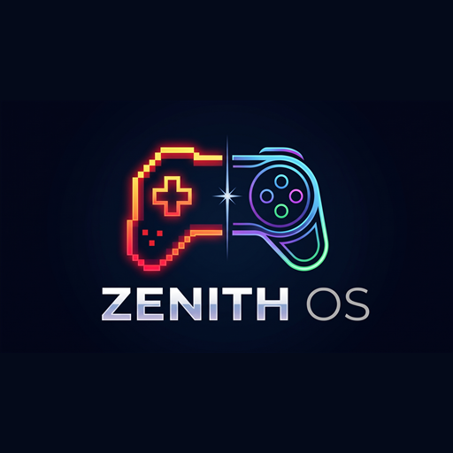

<p align="center">
  
</p>

# Zenith OS

**Your game library, with a console-style experience.**

Zenith OS is a controller-first game launcher and library frontend built with
Electron and React. Browse your games, manage emulators, and launch into play from
a fullscreen dashboard designed for a TV, desktop, or handheld PC.

Despite its name, Zenith OS runs **on Windows or Linux**; it is not a standalone
operating system. Games, console BIOS files, and PS3 firmware are user-provided.

[Releases](https://github.com/aibrhmckr/zenith-os/releases) ·
[User guide](docs/USER_GUIDE.md) ·
[Developer documentation](ARCHITECTURE.md) ·
[Report an issue](https://github.com/aibrhmckr/zenith-os/issues)

## Features

- **Controller-first dashboard.** Fullscreen navigation, responsive poster grids,
  a cinematic game spotlight, and keyboard/mouse support.
- **One library, multiple emulators.** RetroArch integration for libretro cores
  and a separate RPCS3 launch pipeline for PlayStation 3.
- **Guided setup.** Missing-core checks, on-demand core downloads, BIOS status,
  and user-initiated RPCS3 firmware and package installation.
- **Artwork and previews.** Background scraping through Libretro, GameTDB, and
  Archive.org, with local media fallbacks and persistent caching. No mandatory
  API key or paid service is required.
- **Lore and manuals.** Wikipedia summaries and original manual discovery through
  Archive.org, with offline access to cached content.
- **Personalization.** Animated built-in wallpapers, image/video imports,
  configurable audio, English and Turkish interfaces, and remappable exit shortcuts.
- **Console-friendly tools.** An on-screen keyboard, a three-panel file browser,
  notification history, and software-update progress in Settings.

Media availability and emulator compatibility vary by game and platform.
Each media-download category can be enabled or disabled independently.

## Getting Started

### Install and prepare

1. Open [GitHub Releases](https://github.com/aibrhmckr/zenith-os/releases) and choose
   an available artifact for your system. Windows uses an x64 NSIS installer;
   Linux packaging targets x64 AppImage and deb.
2. Launch Zenith OS. The dashboard opens in frameless fullscreen mode. English is
   the default; change it under **Settings → Language**.
3. Select **Add game** and choose a legally obtained game through the in-app file
   browser. ROM imports are copied into Zenith's managed library; the original
   file is preserved. PS3 PKG files follow the RPCS3 installation flow.
4. Select a game and press **A** or **Enter**. If a required core is missing, Zenith
   offers to download it before launching. Supply your own BIOS when prompted.

Use **Settings → System & Console Status** to inspect emulator, core, BIOS, and
PS3 firmware readiness. RPCS3 is installed separately with user consent on
Windows x64; Linux currently requires manual RPCS3 installation.

See the [user guide](docs/USER_GUIDE.md) for detailed setup and the
[RPCS3 guide](RPCS3_INTEGRATION.md) for supported PS3 launch targets.

### Library locations

| Environment                  | Managed game directory                     |
| ---------------------------- | ------------------------------------------ |
| Windows development          | Project-root `games/`                      |
| Windows packaged application | `games/` beside the application executable |
| Linux, including development | `app.getPath('userData')/games/`           |

**Scan library** discovers new games and reuses valid cached media. Use
**Game Options → Search media again** when you explicitly want to refresh artwork
and previews. Incorrect platform detection can be corrected with
**Game Options → Change Platform**.

Downloaded media is stored under `userData/media/{gameId}/`; imported wallpapers
use `userData/wallpapers/`. Nothing is downloaded into project-root media folders.
Deleting a managed game requires confirmation and removes its library copy and
associated per-game media and save data. See the
[storage and runtime reference](docs/RUNTIME.md) before moving or removing data.

### Supported platforms

Platform mappings include PlayStation 1, 2, and 3; PSP; Nintendo DS; Game Boy,
Game Boy Color, and Game Boy Advance; NES; SNES; Nintendo 64; GameCube; Wii;
Nintendo 3DS; Sega Genesis; Dreamcast; Atari 2600, 7800, and Lynx.

Mappings are not a guarantee that every title or file format will run. Available
cores, firmware requirements, and hardware capabilities differ. **Browse cores**
provides manual core selection when automatic mapping is insufficient.

## Controls

The interface switches its button hints to match the most recently used input
device. These are the default dashboard bindings; modal-specific hints take
precedence while a panel is open.

| Action                             | Gamepad            | Keyboard                         |
| ---------------------------------- | ------------------ | -------------------------------- |
| Navigate                           | D-pad / left stick | Arrow keys                       |
| Select or launch                   | A                  | Enter                            |
| Back or close                      | B                  | Escape                           |
| Search                             | Y                  | `/`                              |
| Game Options, when search is empty | X                  | Q / O                            |
| Clear active search                | X                  | X / Backspace outside text input |
| Open console filters               | View               | F                                |
| Change console                     | LB / RB            | PageUp / PageDown                |
| Add game                           | R3                 | + / Insert                       |
| Scan library                       | LT                 | R                                |
| Notifications                      | RT                 | D                                |
| Settings                           | Menu               | Context Menu key                 |
| Zenith session menu                | View + Menu / Home | Escape / F10                     |

Moving up from the first game row focuses the action dock without opening search.
Gamepad search opens the on-screen keyboard: **A** types, **X** deletes,
**Y** inserts a space, and **RT / Start** completes the search. Physical keyboard
search uses the normal text input.

Change the session shortcut under **Settings → Menu & Exit Combination**.
Steam Input, Xbox Game Bar, or desktop shortcuts may intercept controller buttons;
background shortcut support depends on the operating system and input environment.

## Development

### Prerequisites

- Node.js **22.12.0 or newer** and npm. CI uses Node 22.
- A Windows or Linux development environment.
- A native RetroArch runtime for emulator launches and distributable builds.

```sh
git clone https://github.com/aibrhmckr/zenith-os.git
cd zenith-os
npm ci
npm run setup:emulators
npm run dev
```

On Windows x64, `setup:emulators` downloads the official stable RetroArch archive
into `emulators/retroarch/`. On Linux, it creates the directory structure and
prints instructions for installing a native runtime. Existing installations are
preserved. ROMs and BIOS files are never supplied by this setup step.

### Build

```sh
# Compile Main, Preload, and Renderer without creating an installer.
npm run build

# Build the Windows x64 NSIS installer on Windows.
npm run build:win

# Build Linux x64 AppImage and deb packages on Linux.
npm run build:linux
```

Compiled application files go to `out/`; packaged artifacts go to `dist/`.
The Windows installer is named `zenith-<version>-setup.exe`.
The build validates the target-specific RetroArch installation before packaging.
Core binaries, BIOS files, ROMs, RPCS3, and personal emulator data are excluded.

Linux/Steam Deck behavior still needs device-level validation; mocked platform
tests do not establish hardware compatibility. The retained macOS build script
does not imply a supported emulator-packaging workflow.

### Validate changes

```sh
npm run lint
node --test tests/*.test.mjs
npm run build
npm run test:controller
npm run check:distribution
```

Run the relevant Electron integration suites for your change, such as
`test:launcher`, `test:rpcs3`, `test:file-browser`, or `test:app-updates`.
These tests use synthetic fixtures and mocked external services where appropriate;
real controllers, emulators, and installed upgrades need separate verification.

For dependency overrides, proxy configuration, NSIS troubleshooting, and release
publishing, see the [build and release guide](docs/BUILDING.md).

## Updates

**Settings → Software Update** checks Zenith OS and installed emulators, with live
component progress. Packaged Windows releases use GitHub Releases and
`electron-updater`; available differential updates fall back to a full download
when needed. Once staged, select **Restart & install update**, or let it install
on the next normal application quit.

Development builds skip application-installer downloads but can still check
installed emulators. Emulator maintenance preserves configuration, firmware,
virtual disks, and saves. See [update and release details](docs/BUILDING.md#notifications-and-software-updates).

## Documentation

| Guide                                       | Contents                                                                                 |
| ------------------------------------------- | ---------------------------------------------------------------------------------------- |
| [User guide](docs/USER_GUIDE.md)            | Imports, controls, media, manuals, wallpapers, and file browsing                         |
| [Runtime reference](docs/RUNTIME.md)        | `userData` paths, RetroArch launch arguments, `session.cfg`, XAudio, and core validation |
| [Build and release guide](docs/BUILDING.md) | Dependencies, bootstrap, NSIS, Linux packaging, and GitHub OTA releases                  |
| [Architecture](ARCHITECTURE.md)             | Main/Preload/Renderer design, services, IPC contracts, and extension points              |
| [RPCS3 integration](RPCS3_INTEGRATION.md)   | PS3 detection, runtime installation, firmware, packages, and sessions                    |
| [Performance](PERFORMANCE.md)               | Performance analysis, optimization work, and validation notes                            |

## Contributing

Start with the architecture guide and keep changes focused. Include the relevant
tests and update documentation when behavior or configuration changes. Report
bugs with your OS, application version, reproduction steps, and sanitized logs.
Remove personal paths and credentials before sharing diagnostics.

Do not commit ROMs, BIOS/firmware dumps, emulator binaries, downloaded game media,
or personal saves. Run `npm run check:distribution` before submitting changes;
`git config core.hooksPath .githooks` enables the local pre-commit guard. Ignore
rules and automated checks do not establish asset ownership or erase Git history.

## Legal Disclaimer

Zenith OS is an open-source launcher and frontend interface designed for library management and emulator automation. Zenith OS does not contain, distribute, or promote any copyrighted ROMs, ISOs, game assets, or proprietary console BIOS dumps. Users are solely responsible for providing their own legally dumped games and BIOS files.

## Third-Party Licenses & Attribution

- **RetroArch & libretro:** This project utilizes the open-source RetroArch frontend under the GNU General Public License v3.0 (GPL-3.0). RetroArch and the libretro ecosystem are developed and maintained by the Libretro team and contributors; individual emulation cores also have their own upstream developers and licenses. Visit [RetroArch](https://www.retroarch.com) and [Libretro on GitHub](https://github.com/libretro) for source code and documentation.
- Core binaries are not bundled with releases and are downloaded on-demand directly by the user.
- See the [RetroArch GPL v3 license](https://github.com/libretro/RetroArch/blob/master/COPYING) and [Libretro license inventory](https://docs.libretro.com/development/licenses/) for upstream terms. Releases that include RetroArch must preserve its license notices and provide access to the corresponding source for the distributed version in accordance with GPL v3; these attribution links alone do not replace those obligations.

- **RPCS3:** Downloaded only after user consent from [official releases](https://github.com/RPCS3/rpcs3-binaries-win/releases). See the [upstream source and license](https://github.com/RPCS3/rpcs3). Sony firmware and game packages remain user-provided.
- **7-Zip extraction helper:** The 7zip-bin wrapper uses MIT; its bundled Windows 7za 21.07 uses upstream 7-Zip license terms. Included notices and LGPL text are in [resources/licenses](resources/licenses); [7-Zip 21.07 source](https://github.com/ip7z/7zip/tree/21.07) and [helper build sources](https://github.com/develar/7zip-bin) are available upstream. Preserve notices and satisfy corresponding-source obligations when distributing this helper.
